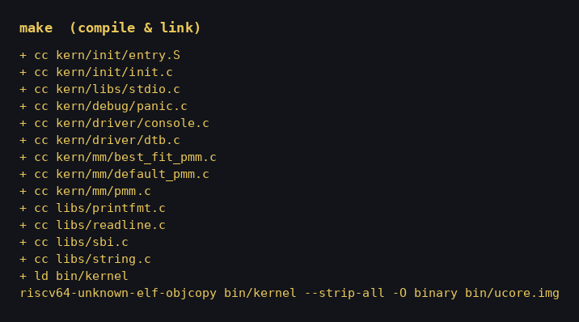
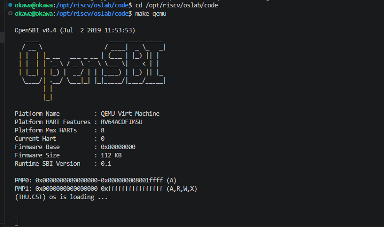
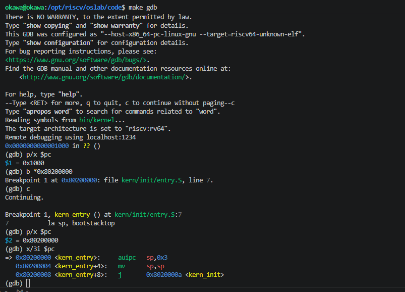

# 操作系统实验报告

## 实验基本信息

| 项目 | 内容 |
|------|------|
| **实验名称** | Lab 1: 比麻雀更小的麻雀（最小可执行内核） |
| **小组成员** | 学号1-姓名1、学号2-姓名2、学号3-姓名3 |
| **完成日期** | 2026-10-10 |

### 小组分工

| 成员 | 负责的练习/模块 |
|------|----------------|
| 学号1-姓名1 | 练习 1、练习 2（每人独立完成全部内容） |
| 学号2-姓名2 | 练习 1、练习 2（每人独立完成全部内容） |
| 学号3-姓名3 | 练习 1、练习 2（每人独立完成全部内容） |

> 本实验每位成员均独立完成了 lab1 的全部内容（练习 1 的入口指令分析、练习 2 的 GDB 启动流程验证），随后汇总形成本报告。

---

## 一、实验目的

本实验的主要目的是：

1. 理解 RISC-V 上最小可执行内核的启动流程：从机器加电、OpenSBI 固件初始化到内核接管控制权的完整过程。
2. 使用**链接脚本**描述内核的内存布局，理解入口点（`kern_entry`）、代码/数据/BSS 各段如何被安排到约定地址（`0x80200000`）。
3. 使用**交叉编译**（`riscv64-unknown-elf-*` 工具链）生成 ELF 可执行文件，并进一步生成内核镜像（`ucore.img`）。
4. 使用 **OpenSBI** 作为 bootloader 加载内核镜像，并用 QEMU 模拟 64 位 RISC-V 计算机运行内核。
5. 使用 OpenSBI 提供的服务在屏幕上格式化打印字符串（`(THU.CST) os is loading ...`），作为后续调试的基础。
6. 学习使用 **GDB 远程调试**内核，并借助 AI 辅助完成操作系统开发。

---

## 二、实验环境

| 成员 | AI 编程工具 | 底层模型 | 备注 |
|------|------------|---------|------|
| 学号1-姓名1 | Claude Code（VS Code 扩展，终端 Agent） | DeepSeek V4 Pro（`deepseek-v4-pro`） | WSL2 / Ubuntu（Linux 6.18.33.2），工具链 `riscv64-unknown-elf-*`，QEMU `qemu-system-riscv64` |
| 学号2-姓名2 | | | |
| 学号3-姓名3 | | | |

**说明：**
- **AI 编程工具**：Claude Code 作为终端 Agent，在 VS Code 扩展环境中运行。
- **底层模型**：会话使用 DeepSeek V4 Pro（`deepseek-v4-pro`），通过 cc-switch 配置模型路由。

---

## 三、实验整体逻辑分析

### 3.1 本章节的逻辑主线

本章围绕「**让一个最小内核在 RISC-V 上跑起来并打印一句话**」这一核心主题展开，解决的核心问题是：**如何让一段裸机程序从「机器加电」走到「能运行 C 代码」**。整章是一条自上而下、层层交接的链路：

```
机器加电 → OpenSBI 固件（0x1000 复位）→ 加载内核到 0x80200000 → 内核入口 kern_entry
        → 建栈（la sp, bootstacktop）→ 进 C（tail kern_init）→ 清 BSS、打印、死循环
```

支撑这条链路的两个基础设施是：**链接脚本**（决定内核被放到哪、入口在哪）和 **Makefile**（一条命令完成编译/链接/生成镜像/启动 QEMU）。

### 3.2 功能的逐步实现

1. **首先建立内核的内存布局**（`tools/kernel.ld`）→ 因为内核要运行在约定地址 `0x80200000`，必须先确定各段的排布和入口点，这是后续一切运行的前提。
2. **接着编写内核入口汇编**（`kern/init/entry.S`）→ 有了布局后，需要一段从「固件交棒」到「能跑 C」的桥接代码：建栈 + 跳入 C 入口。
3. **然后实现 C 入口**（`kern/init/init.c`）→ 有了可用的栈后，进入 C 代码完成 BSS 清零和打印，标志内核最小系统运行成功。
4. **最后用 Makefile 串联构建与运行**（`Makefile` + `tools/function.mk`）→ 把编译、链接、生成镜像、启动 QEMU 收敛为一条 `make qemu`，形成完整闭环。

---

## 四、实验内容与实现

### 练习 1：理解内核启动中的程序入口操作

**负责人：** 全体成员（每人独立完成）

#### 练习解答

阅读 `kern/init/entry.S`：

```asm
kern_entry:
    la sp, bootstacktop
    tail kern_init
```

**（1）`la sp, bootstacktop` 完成了什么操作？目的是什么？**

`la` 是「load address」伪指令，展开为 `auipc sp, %pcrel_hi(...)` + `addi sp, sp, %pcrel_lo(...)`，把符号 `bootstacktop` 的**地址**加载到栈指针 `sp`（加载的是地址，不是该地址处的内容）。`bootstacktop` 是内核启动栈 `bootstack`（`.space KSTACKSIZE`，8KB）的最高地址，即栈顶。

**目的**：RISC-V 的栈向下生长，`sp` 必须指向栈顶。内核刚从 OpenSBI 接手时还没有自己的栈，任何 C 函数调用（保存返回地址、分配局部变量）都需要栈。这条指令为内核建立一块合法可用的启动栈，为进入 C 代码做准备。

**（2）`tail kern_init` 完成了什么操作？目的是什么？**

`tail` 是尾调用伪指令，展开为 `auipc t1, %pcrel_hi(...)` + `jalr x0, t1, %pcrel_lo(...)`，直接跳转到 `kern_init`，且**不保存返回地址**（跳转寄存器是 `x0` 而非 `ra`）。

**目的**：`kern_init` 被声明为 `__attribute__((noreturn))`，结尾是 `while(1)` 死循环，永不返回。既然不返回，就无需保存返回地址，用 `tail`（不存 `ra`）比普通 `call` 更高效，语义上也更准确——把控制权**永久**交给 C 入口。（GDB 实测 `tail kern_init` 被汇编为 `j 0x8020000a`，即 `jal x0, ...`。）

#### AI 协作提示词

```markdown
练习1：理解内核启动中的程序入口操作。
阅读 kern/init/entry.S 内容代码，结合操作系统内核启动流程，说明：
1. 指令 la sp, bootstacktop 完成了什么操作，目的是什么？
2. tail kern_init 完成了什么操作，目的是什么？
```

#### 实现迭代过程

本练习为代码分析类任务，**1 次迭代即完成**：

- AI 阅读 `entry.S` 及关联的 `kernel.ld`、`memlayout.h`、`init.c`，给出 `la`/`tail` 两条伪指令的展开形式、操作与目的；
- 结果经 GDB 反汇编交叉验证（`la sp, bootstacktop` → `auipc sp,0x3` + `mv sp,sp`；`tail kern_init` → `j 0x8020000a`），结论正确，无需修改提示词。

**最终结果：**
- ✅ 结论与反汇编、符号表一致
- ✅ 功能符合预期

---

### 练习 2：使用 GDB 验证启动流程

**负责人：** 全体成员（每人独立完成）

#### 练习解答

**调试过程与观察结果：**

两个终端配合：终端 1 执行 `make debug`（QEMU 以 `-s -S` 冻结在复位、监听 `:1234`），终端 2 执行 `make gdb`（`target remote localhost:1234`）。

① 连接后 CPU 停在复位地址，查看第一条指令：

```
$pc = 0x1000
$sp = 0x0            # 栈指针还未初始化
=> 0x1000:  auipc t0,0x0
   0x1004:  addi a1,t0,32
   0x1008:  csrr a0,mhartid
   0x100c:  ld   t0,24(t0)
   0x1010:  jr   t0
```

② 在内核入口打断点并继续：

```
(gdb) b *0x80200000
(gdb) c
Breakpoint 1, kern_entry () at kern/init/entry.S:7
7       la sp, bootstacktop

$pc = 0x80200000
$sp = 0x8001bd80      # 仍是 OpenSBI 建的栈
=> 0x80200000 <kern_entry>:   auipc sp,0x3
   0x80200004 <kern_entry+4>: mv   sp,sp
   0x80200008 <kern_entry+8>: j    0x8020000a <kern_init>
```

③ 单步执行 `la sp, bootstacktop`，观察栈切换：

```
(gdb) si
(gdb) p/x $sp
$sp = 0x80203000      # = bootstacktop，内核自己的启动栈顶
```

**问题回答：**

**Q1：RISC-V 硬件加电后最初执行的几条指令位于什么地址？**

复位向量地址 **`0x1000`**。加电后 `pc` 从 `0x1000` 开始取指，这里放的是固件（OpenSBI 的 `fw_dynamic` 入口）的启动跳板代码。

**Q2：它们主要完成了哪些功能？**

| 指令 | 功能 |
| --- | --- |
| `auipc t0,0x0` | `t0 = 当前 PC(0x1000)`，用 PC 相对寻址取得固件自身加载基址 |
| `addi a1,t0,32` | `a1 = 0x1020`，指向固件动态信息结构体 `fw_dynamic_info`，作为参数传递 |
| `csrr a0,mhartid` | `a0 = mhartid`，读当前硬件线程（hart）ID，作为参数 |
| `ld t0,24(t0)` | 从 `0x1018` 读出 `next_addr`（下一阶段入口地址） |
| `jr t0` | 跳转到该入口，开始 OpenSBI 主体初始化 |

即这 5 条指令完成了「定位自身 → 准备参数（hart id、固件信息指针）→ 读取下一阶段入口 → 跳转」，把执行流交给 OpenSBI 主初始化，最终 OpenSBI 跳转到 `0x80200000` 将控制权移交给内核。

**补充观察：** 本实验用 `-device loader,file=bin/ucore.img,addr=0x80200000` 把内核在 QEMU 复位前就预加载到 `0x80200000`，因此复位那一刻该地址就已是内核代码，`watch *0x80200000` 观察不到「内核被加载的瞬间」；用 `b *0x80200000` 打断点是更可靠的验证方式。

#### AI 协作提示词

```markdown
练习2：使用GDB验证启动流程。
使用 GDB 跟踪 QEMU 模拟的 RISC-V 从加电开始，直到执行内核第一条指令
（跳转到 0x80200000）的整个过程。请给出调试步骤，并回答：
1. RISC-V 硬件加电后最初执行的几条指令位于什么地址？
2. 它们主要完成了哪些功能？
```

#### 实现迭代过程

本练习经历了 **3 次迭代**，过程如下：

**第一次迭代：`make debug` 疑似"卡死"**

- **遇到的问题：** 终端 1 执行 `make debug` 后无任何输出、无提示符，误以为是死机。
- **问题解决策略：** 经排查，这是正常现象——`make debug` 使用 `-s -S`，`-S` 让 CPU 冻结在复位状态、`-nographic` 无图形窗口，QEMU 只是静默监听 `:1234` 等待 GDB 连接。**无需修改，保持终端 1 运行即可。**

**第二次迭代：GDB 连接失败，`No registers`**

- **遇到的问题：** `make gdb` 报 `could not connect: Interrupted system call`，随后 `p/x $pc` 显示 `No registers`。
- **问题解决策略：** 定位为 QEMU 的 gdb 调试桩卡死在坏状态（此前一次连接被强行中断所致）。**杀掉卡死的 QEMU 进程后重新 `make debug` + `make gdb`。**

**第三次迭代：成功完成验证**

- 重启后连接成功，依次完成：复位地址 `0x1000` 反汇编 → 断点 `b *0x80200000` 命中 → 单步观察 `sp` 从 `0x8001bd80` 切换到 `0x80203000`（`bootstacktop`）。

**最终结果：**
- ✅ 复位地址、固件入口、内核入口、栈切换全部验证通过
- ✅ 观察结果与理论分析一致

---

## 五、测试与验证

**测试截图：**

1. 编译链接成功（`make` 输出，生成 `bin/kernel` 与 `bin/ucore.img`）：



2. 内核启动成功（`make qemu` 输出，出现 `(THU.CST) os is loading ...`）：



3. GDB 断点命中内核入口（`b *0x80200000`）：



> 注：lab1 的 `make grade` 目标仅执行 `make clean`，无独立测试用例，故未单独截图。

---

## 六、实验总结与收获

### 对操作系统的理解

**1. 本实验重要知识点与 OS 原理对照：**

| 本实验知识点 | OS 原理对应 | 含义、关系与差异 |
| --- | --- | --- |
| 复位向量 `0x1000`、OpenSBI 固件启动 | 系统引导（Bootloader / UEFI） | 都是「固件 → 引导 → 内核」的接力；原理课讲 UEFI/GRUB，实验用 OpenSBI，机制相同、实现不同 |
| `la sp, bootstacktop` 建立内核栈 | 进程栈、函数调用约定 | 栈向下生长、`sp` 指向栈顶；内核启动栈是最早的运行栈，与进程栈同构但更底层 |
| `tail kern_init` 尾调用 | 过程调用与返回地址（`ra`） | 普通 `call` 保存返回地址，`tail` 不保存——因 `kern_init` 是 `noreturn`；体现调用约定在底层的落地 |
| 链接脚本布局 `.text/.data/.bss` | 程序内存布局 / 地址空间 | 链接脚本决定各段位置，是「逻辑→物理地址」的静态版本；本实验无页表，靠链接地址与加载地址一致保证正确 |
| SBI 调用（`libs/sbi.c`） | 系统调用 / 固件接口 | SBI 是 S 态内核调用 M 态固件的接口，是系统调用思想的雏形；差异在于 SBI 是固件接口，syscall 是 OS 给用户态的接口 |
| 清 BSS（`memset(edata, 0, end-edata)`） | 可执行文件加载 / 运行时初始化 | 加载器要保证未初始化全局变量为 0；实验里内核是「自加载」，故自己完成此事 |

**2. OS 原理中重要、但本实验未覆盖的知识点：**

1. **中断与异常**（对应 lab3）：本实验内核只能顺序执行、死循环，无法响应外部事件。
2. **物理内存管理与页表 / 虚拟内存**（对应 lab2）：直接使用固定物理地址，没有内存分配器与地址翻译。
3. **进程 / 线程与调度**（对应 lab4、lab6）：只有一个控制流，没有 PCB、上下文切换和调度算法。
4. **同步与互斥**（对应 lab7）：单控制流下无竞争，无需信号量、管程。
5. **文件系统与设备抽象**（对应 lab8）：没有磁盘、文件、VFS，输出只靠 SBI 字符输出。
6. **系统调用与用户态**（对应 lab5）：还没有用户程序，没有 syscall 与用户态/内核态切换。

### AI 协作开发的经验

1. **AI 在「解释概念」上高效、在「动手调试」上需人主导。** 练习 1 的伪指令分析，AI 一次给出准确答案并经反汇编验证；但练习 2 的 GDB 调试中遇到的「`make debug` 卡死」「gdb stub 连接失败」等问题，需要结合环境实际状态逐步定位，AI 的作用是给出排查方向（分层验证），最终由人执行重启、杀进程等操作。
2. **「分层验证」是排查底层问题的有效方法。** 面对 `could not connect`，AI 先区分「端口是否监听」「进程是否存活」「连接是否被中断」，把「网络/环境问题」和「代码问题」分开，避免了盲目重装工具链。
3. **AI 的结论需要交叉验证。** 练习 1 的指令展开、练习 2 的地址值，都通过 `objdump`、`nm`、GDB 实测数据进行了二次确认，而非直接采信 AI 描述——这是底层开发中尤其重要的习惯。
4. **提示词越具体，AI 越能给出可执行的结果。** 练习 2 中把「跟踪启动流程」细化为「看复位地址、打断点、观察 sp 变化」后，AI 给出的步骤可直接照做。
