# 操作系统实验报告

## 实验基本信息

| 项目 | 内容 |
|------|------|
| **实验名称** | Lab 2: 物理内存和页表 |
| **小组成员** | 2411590-李幸之、2411839-侯大川、2411207-孙曌宣 |
| **完成日期** | 2026-10-20 |

### 小组分工

| 成员 | 负责的练习/模块 |
|------|----------------|
| 2411590-李幸之 | 功能模块一（page_init）、功能模块二（First-Fit 理解 + Best-Fit） |
| 2411839-侯大川 | 功能模块一（page_init）、功能模块二（First-Fit 理解 + Best-Fit） |
| 2411207-孙曌宣 | 功能模块一（page_init）、功能模块二（First-Fit 理解 + Best-Fit） |

> 本实验每位成员独立完成核心编程任务（物理内存探测与页描述符初始化 `page_init`、Best-Fit 分配器实现与接入），随后汇总形成本报告。

---

## 一、实验目的

1. 理解 **页表** 的建立与使用方法：掌握 Sv39 多级页表结构、页表项（PTE）格式、`satp` 寄存器与地址翻译过程。
2. 理解 **物理内存的管理方法**：掌握操作系统如何发现系统物理内存（设备树 / DTB），如何用 Page 描述符数组组织物理页，以及空闲页链表（`free_area_t`）的建立。
3. 理解 **页面分配算法**：掌握 First-Fit 连续分配算法，并在此基础上实现 Best-Fit 分配算法，理解不同分配策略对内存碎片的影响。
4. 理解 **段页式内存管理** 的整体机制：建立「虚拟地址 → 物理地址」的映射关系，完成从「只能直接访问物理地址」到「通过页表访问虚拟地址」的切换。

---

## 二、实验环境

| 成员 | AI 编程工具 | 底层模型 | 备注 |
|------|------------|---------|------|
| 2411590-李幸之 | DeepSeek Harness（DSH，终端 Agent） | DeepSeek Flash（`deepseek-V41-flash`） | WSL2 / Ubuntu（Linux 6.18.33.2），工具链 `riscv64-unknown-elf-*`，QEMU `qemu-system-riscv64` |
| 2411839-侯大川 | Claude Code（VS Code 扩展，终端 Agent） | DeepSeek V4 Pro（`deepseek-v4-pro`） | WSL2 / Ubuntu（Linux 6.18.33.2），工具链 `riscv64-unknown-elf-*`，QEMU `qemu-system-riscv64` |
| 2411207-孙曌宣 | Codex（桌面版） | GPT-6 | Ubuntu 25.10（Linux 6.17.0-41-generic，x86_64）；RISC-V GCC 10.2.0、GDB 10.1、QEMU 7.0.0 |

---

## 三、实验整体逻辑分析

### 3.1 本章节的逻辑主线

本章围绕「**操作系统如何发现、组织并分配物理内存，并在此基础上建立页表**」这一核心主题展开。整章可以概括为一条「自底向上」的实现链：

```
设备树(DTB)探测物理内存范围 → 建立 Page 描述符数组(page_init)
    → 建立空闲页链表(init_memmap) → 页面分配算法(First-Fit/Best-Fit)
    → 页表机制(Sv39, satp) → 虚拟地址与物理地址的映射
```

其逻辑顺序是：

1. **先解决「内存有多少、在哪里」**（物理内存探测）—— 通过 OpenSBI 传给内核的设备树（DTB，地址保存在 `a1` 寄存器）读出 DRAM 的基址与大小。
2. **再解决「如何描述每一页」**（Page 描述符）—— 为物理内存的每一页建立一个 `struct Page` 描述符，连续排列成数组，记录该页的引用计数、状态标志、空闲块大小等信息。
3. **然后解决「空闲页如何组织」**（空闲链表）—— 把描述符数组之后、内存末端之前的完整空闲页通过 `init_memmap` 交给物理内存管理器，组织成按地址排序的双向链表。
4. **接着解决「如何分配与回收」**（分配算法）—— 在 `pmm_manager` 框架下实现具体的分配策略（First-Fit、Best-Fit）。
5. **最后解决「如何建立虚实映射」**（页表）—— 在 `entry.S` 中构造一个只含一个 1GiB 大页的启动页表，设置 `satp` 使能 Sv39 分页，让内核从物理地址空间切换到虚拟地址空间运行。

### 3.2 功能的逐步实现

1. **`kern/init/entry.S`** —— 构造启动页表 `boot_page_table_sv39`：将 `[0xffffffffc0000000, ...)` 的虚拟地址映射到 `[0x80000000, 0xc0000000)` 的物理地址（一个 1GiB 大页），设置 `satp` 使能 Sv39，刷新 TLB，再跳入 C 代码。
2. **`kern/driver/dtb.c`** —— 解析设备树，读出 DRAM 的 `memory_base` / `memory_size`，对外提供 `get_memory_base()` / `get_memory_size()`。
3. **`kern/mm/pmm.c`** —— 实现 `page_init()`：根据设备树信息建立 Page 描述符数组，计算空闲页范围并交给管理器；实现 `init_pmm_manager()` 选择管理器，`pmm_init()` 串起整个初始化流程。
4. **`kern/mm/default_pmm.c`** —— 提供 First-Fit 完整参考实现（本实验的「读懂」对象）。
5. **`kern/mm/best_fit_pmm.c`** —— 实现 Best-Fit 分配器（本实验的「写」对象），并在 `init_pmm_manager()` 中切换到它。

---

## 四、实验内容与实现

### 功能模块一：物理内存初始化

#### 任务一：实现物理内存探测与页描述符初始化（`page_init`）

**需求分析**

`page_init()` 要完成「从设备树信息到可用空闲页」的转换：内核从设备树得知 DRAM 物理范围后，需要为其中可管理的每一页建立 `struct Page` 描述符，并把「内核镜像 + 描述符数组」之外的完整页面交给物理内存管理器。

实现时必须区分四类地址/编号：

| 概念 | 含义 | 示例 |
|------|------|------|
| 虚拟地址 VA | 内核链接、运行使用的地址 | `end = 0xffffffffc0206078` |
| 物理地址 PA | 内存总线上的真实地址 | `PADDR(end) = 0x80206078` |
| 物理页号 PPN | `地址 >> 12`，一页 4KiB | `PPN(0x80200000) = 0x80200` |
| Page 描述符地址 | `struct Page` 数组的某个元素 | `pages[i]` |

关键内存布局（初始化后）：

```
[OpenSBI] [内核镜像] [对齐空隙] [Page 描述符数组] [对齐空隙] [可分配连续物理页]
0x80000000  0x80200000              pages=RUP(end)   freemem            mem_end(0x88000000)
```

**核心代码**（`kern/mm/pmm.c`，对应注释 `//lab2 function1`）：

```c
//lab2 function1
static void page_init(void) {
    // 从设备树获取物理内存的起点与大小
    uint64_t mem_begin = get_memory_base();
    uint64_t mem_size = get_memory_size();

    // 设备树信息无效时，终止初始化
    if (mem_begin == 0 || mem_size == 0) {
        panic("page_init: invalid physical memory info from DTB");
    }
    uint64_t mem_end = mem_begin + mem_size;

    // 建立虚拟地址与物理地址之间的映射偏移量（供 PADDR 使用）
    va_pa_offset = PHYSICAL_MEMORY_OFFSET;

    // 内核可管理的物理页号上界
    npage = PPN(mem_end);
    if (npage <= nbase) {
        panic("page_init: no usable physical memory");
    }

    // Page 描述符数组紧跟在链接符号 end 之后，并按页对齐
    extern char end[];
    pages = (struct Page *)ROUNDUP((uintptr_t)end, PGSIZE);

    // 先把 [nbase, npage) 范围内的所有页都置为保留状态
    for (size_t i = 0; i < npage - nbase; i++) {
        SetPageReserved(pages + i);
    }

    // 描述符数组之后的地址向上按页对齐，得到第一个可分配物理页
    uintptr_t freemem = ROUNDUP((uintptr_t)pages +
                                (npage - nbase) * sizeof(struct Page), PGSIZE);
    uintptr_t freemem_pa = PADDR(freemem);

    // 输出探测到的物理内存范围
    cprintf("physical memory map:\n");
    cprintf("memory: 0x%016lx, [0x%016lx, 0x%016lx].\n",
            mem_size, mem_begin, mem_end - 1);

    // 只有描述符数组之后、内存末端之前完整的页面才交给分配器
    size_t free_start = PPN(freemem_pa);
    if (free_start < npage) {
        init_memmap(pa2page(freemem_pa), npage - free_start);
    }
}
```

**实现要点说明**

1. **`va_pa_offset = PHYSICAL_MEMORY_OFFSET`**：`PADDR(kva) = kva - va_pa_offset`，是内核虚拟地址到物理地址的换算依据，必须在任何 `PADDR` 调用之前设置好。
2. **`npage = PPN(mem_end)`**：可管理物理页号上界；`nbase = DRAM_BASE / PGSIZE` 是 DRAM 起始页号。因此描述符数组需要覆盖 `[nbase, npage)` 共 `npage - nbase` 个物理页。
3. **`pages` 放在 `end` 之后并按页对齐**：描述符数组本身也占用物理内存，所以它所在的页面必须保持「保留」状态，不能进入空闲区。
4. **先把所有页标记保留**，再只对描述符数组之后的部分调用 `init_memmap`。`init_memmap` 内部会通过 `p->flags = 0` 清除保留位并建立空闲链表，因此「保留页」与「空闲页」被正确区分。
5. **页面对齐**：描述符数组之后向上对齐（`ROUNDUP`）得到 `freemem`，内存末端 `npage = PPN(mem_end)` 天然向下取整，末尾不足一页的部分不会进入空闲区。

**任务 Prompt（AI 协作）**

```text
[PROMPT]
任务：在 kern/mm/pmm.c 的 lab2 function1 标记处完成 page_init，
实现物理内存探测、页描述符初始化和空闲页注册。
操作要求：修改实际文件，保留已有代码、lab2 注释和测试，不改变管理器选择。
输出要求：给出修改说明和实际验证结果，未运行的检查明确注明。

[RELY]
读取 pmm.c/h、memlayout.h、mmu.h、dtb.h 和 entry.S，以真实定义为准。
可用 get_memory_base、get_memory_size、init_memmap、pa2page、PADDR、
页对齐及 Page 状态宏、panic、cprintf、链接符号 end。
全局量为 pages、npage、nbase、va_pa_offset；Page 含 ref、flags、
property、page_link。nbase=DRAM_BASE/PGSIZE，描述符数量为 npage-nbase。
当前平台使用从 DRAM_BASE 开始的单段 RAM 和既定直接映射。

[GUARANTEE]
static void page_init(void);
允许增加文件内 static 辅助函数，不修改公共接口。

[SPECIFICATION]
## page_init
Pre-Condition：DTB 和启动映射已就绪，当前管理器已初始化但未注册空闲页。
Post-Condition：
- va_pa_offset 与启动映射一致，等于 PHYSICAL_MEMORY_OFFSET。
- 有效物理上界取 RAM 末端与 PHYSICAL_MEMORY_END 的较小值并向下页对齐；
  npage 表示该上界的物理页号，不是描述符数量。
- pages 位于 end 之后的第一个页边界，容纳 npage-nbase 个描述符；
  pages[i] 对应物理页号 nbase+i，数组及对齐占用不得越界。
- OpenSBI、内核和描述符数组占用页保持保留；其后的完整空闲页全部交给
  管理器，并输出探测到的内存范围。
Case 1：DTB 无效、基址不符合当前平台、计算溢出或布局越界时，panic 终止，
不得先越界访问或注册错误页面。
Case 2：没有剩余完整页时，不调用 init_memmap，报告内存不足并终止启动。
Requirements：区分虚拟地址、物理地址、物理页号和描述符指针；
各描述符初始状态确定，地址与长度检查先于内存写入。
```

---

### 功能模块二：物理内存分配

#### 任务一：理解 First-Fit 连续物理内存分配算法（思考题）

阅读 `kern/mm/default_pmm.c`，First-Fit 分配器由以下核心函数构成：

| 函数 | 作用 |
|------|------|
| `default_init()` | 初始化空闲链表 `free_list`，`nr_free = 0` |
| `default_init_memmap(base, n)` | 把 `[base, base+n)` 登记为一个空闲块：清空每页 `flags/property/ref`，令 `base->property = n`、`SetPageProperty(base)`，并把 `base` 按地址升序插入 `free_list` |
| `default_alloc_pages(n)` | 从链表头开始找第一个 `property >= n` 的空闲块；若块比 `n` 大则分裂，把剩余部分作为新块插回，`nr_free -= n` |
| `default_free_pages(base, n)` | 释放 `[base, base+n)`：清标志、`base->property = n`、按地址插入链表，再分别与前后相邻空闲块合并（`p + p->property == base` 或 `base + base->property == p`） |

**First-Fit 的完整流程（用自己的话概括）：**

- **初始化空闲页**：`page_init` 算出唯一的连续空闲区间后，`init_memmap` 把它做成一个 `property = 总页数` 的空闲块头节点，插入（初始为空，直接加入）空闲链表，`nr_free` 记录总空闲页数。
- **分配连续物理页**：请求 `n` 页时，从链表头开始线性扫描，命中第一个「块大小 ≥ n」的块，把该块从链表摘下；若块比 `n` 大，就把 `base + n` 处作为新的块头（`property = 原块 - n`）插回原位置，实现「分裂」；`nr_free` 减 `n`，并清除分配出去页头的 `PG_property`。
- **回收页面并合并**：释放时先按地址把释放块插入链表（保持有序），然后检查其前驱：若 `前驱 + 前驱.property == 本块`，则把本块并入前驱；再检查后继：若 `本块 + 本块.property == 后继`，则把后继并入本块。这样相邻空闲块始终合并成一块，减少外部碎片。

**问题：原有的 First-Fit 算法是否有进一步的改进空间？**

有。主要在于：

1. **查找是 O(n) 线性扫描**：空闲块越多，分配越慢。可以用红黑树 / 按大小排序的堆 / 空闲块大小分桶（segregated free list）把「找到合适块」降到 O(log n) 甚至 O(1)。
2. **低地址块被频繁分裂**：First-Fit 倾向从低地址开始分配，长期运行后低地址区碎成大量小块，高地址区反而空闲，产生「碎片向头部聚集」现象。可改用 Next-Fit（从上次分配位置继续）缓解。
3. **分裂阈值缺失**：当剩余部分很小（如只剩 1 页）时仍要维护一个新节点，开销大于收益。可设定「最小分裂阈值」，剩余过小则整块分配不分裂。

#### 任务二：实现 Best-Fit 连续物理内存分配算法

**需求分析**

Best-Fit 与 First-Fit 的区别**仅在分配策略**：分配 `n` 页时，不选第一个「够大」的块，而是遍历整个空闲链表，选「大小 ≥ n 且最接近 n」的那一块（即 `property` 最小的满足项），从而把残留碎片降到最小。其余（初始化、回收、合并、`nr_free_pages`）与 First-Fit 完全一致。

文件 `best_fit_pmm.c` 只提供了 `basic_check` / `best_fit_check` 两个测试函数，管理函数的声明和注册结构需自行设计，且**不得修改两个测试函数**——因此内部状态必须遵守测试的约定（用 `free_area_t free_area` + `free_list` / `nr_free` 宏）。

**核心代码**（`kern/mm/best_fit_pmm.c`，对应注释 `//lab2 function2-2`）：

```c
//lab2 function2-2
static free_area_t free_area;

#define free_list (free_area.free_list)
#define nr_free (free_area.nr_free)

// best_fit_init / best_fit_init_memmap / best_fit_free_pages /
// best_fit_nr_free_pages 与 default_pmm.c 对应实现相同（略）

static struct Page *
best_fit_alloc_pages(size_t n) {
    assert(n > 0);
    if (n > nr_free) {
        return NULL;
    }
    struct Page *page = NULL;
    list_entry_t *le = &free_list;
    while ((le = list_next(le)) != &free_list) {
        struct Page *p = le2page(le, page_link);
        // 在 property >= n 的空闲块中，记录 property 最小的那一个
        if (p->property >= n &&
            (page == NULL || p->property < page->property)) {
            page = p;
        }
    }
    if (page != NULL) {
        list_entry_t *prev = list_prev(&(page->page_link));
        list_del(&(page->page_link));
        // 若该空闲块大于 n，把剩余部分作为新的空闲块插回原位置
        if (page->property > n) {
            struct Page *p = page + n;
            p->property = page->property - n;
            SetPageProperty(p);
            list_add(prev, &(p->page_link));
        }
        nr_free -= n;
        ClearPageProperty(page);
    }
    return page;
}

const struct pmm_manager best_fit_pmm_manager = {
    .name = "best_fit_pmm_manager",
    .init = best_fit_init,
    .init_memmap = best_fit_init_memmap,
    .alloc_pages = best_fit_alloc_pages,
    .free_pages = best_fit_free_pages,
    .nr_free_pages = best_fit_nr_free_pages,
    .check = best_fit_check,
};
```

**接入内核**：在 `kern/mm/pmm.c` 的 `init_pmm_manager()` 中把管理器从 `default_pmm_manager` 切换为 `best_fit_pmm_manager`：

```c
static void init_pmm_manager(void) {
    pmm_manager = &best_fit_pmm_manager;
    cprintf("memory management: %s\n", pmm_manager->name);
    pmm_manager->init();
}
```

**Best-Fit 与 First-Fit 的分配差异**：以 `best_fit_check` 为例，空闲链表里有两个块 `[p0+1, 2 页]` 和 `[p0+4, 1 页]`，请求 1 页时——First-Fit 会选 `p0+1`（第一个够大的块），而 Best-Fit 会选 `p0+4`（`property=1` 更贴合）。测试正是靠 `assert(p0 + 4 == p1)` 来验证这一点。

**任务 Prompt（AI 协作）**

```text
[PROMPT]
任务：在 kern/mm/best_fit_pmm.c 中完成 Best-Fit 模块，并在 pmm.c
的 init_pmm_manager 中切换为 best_fit_pmm_manager。
操作要求：修改实际文件，保留 lab2 标记、basic_check、best_fit_check
及评分测试，不修改公共结构或已完成的 page_init。
输出要求：说明修改及实际验证结果，确认内核确实使用 Best-Fit。

[RELY]
参考 default_pmm.c，读取 pmm.h、memlayout.h、best_fit_pmm.h 和 libs/list.h。
PageProperty 标识空闲块头，property 表示块页数，page_link 用于链表。
free_area_t 包含 free_list 和 nr_free；原测试直接保存和恢复这两个状态，
并会构造“链表为空但计数尚未清零”的情况。
原测试允许释放已分配块的子区间，也允许合并释放相邻的已分配区间。

[GUARANTEE]
static void best_fit_init(void);
static void best_fit_init_memmap(struct Page *base, size_t n);
static struct Page *best_fit_alloc_pages(size_t n);
static void best_fit_free_pages(struct Page *base, size_t n);
static size_t best_fit_nr_free_pages(void);
const struct pmm_manager best_fit_pmm_manager;
修改 pmm.c 中 static void init_pmm_manager(void)。
提供测试需要的 free_list、nr_free；注册对象的 check 绑定已有 best_fit_check。
允许 static 辅助函数。

[SPECIFICATION]
## best_fit_init
Pre-Condition：首次初始化，无活动分配。
Post-Condition：空闲链表有效且为空，nr_free=0。

## best_fit_init_memmap
Pre-Condition：n>0，给定页面连续、有效、仍保留且未注册。
Post-Condition：全部页面转为空闲，ref=0，计数增加 n；链表按地址有序，
相邻空闲区合并，只有块头保留 PageProperty 和有效长度。

## best_fit_alloc_pages
Pre-Condition：n>0，管理器已初始化。
Post-Condition：成功返回独占的连续 n 页，计数减少 n，返回头不带
PageProperty，ref=0；失败返回 NULL 且状态不变。
Case 1：选择长度不小于 n 的最小空闲块，同长时选低地址块；
从低地址端分配，剩余部分继续作为合法空闲块。
Case 2：链表为空、总量不足或缺少足够连续空间时，分配失败。

## best_fit_free_pages
Pre-Condition：n>0，区间全部已分配、非保留且未释放；允许上述子区间释放。
Post-Condition：ref 清零，计数增加 n，按地址归还并合并两侧相邻空闲块；
合并不重复计数，失效块头标记清除。

## best_fit_nr_free_pages
Pre-Condition：管理器已初始化。
Post-Condition：只读返回空闲页总数，正常状态下等于各空闲块长度之和。

## init_pmm_manager
Pre-Condition：尚未注册空闲区，无活动分配。
Post-Condition：选择 Best-Fit，打印名称并调用一次 init，后续使用同一管理器。

Requirements：n=0 按框架约定断言拒绝；验证最小合适块、分裂、双侧合并、
连续空间不足和全部回收后的计数恢复，不修改原测试以迎合实现。
```

**问题：你的 Best-Fit 算法是否有进一步的改进空间？**

有。

1. **查找仍是 O(n)**：Best-Fit 需要遍历整个空闲链表找「最小满足项」，比 First-Fit 平均更慢。可用按 `property` 排序的红黑树/最小堆优化到 O(log n)。
2. **Best-Fit 的固有缺陷——产生更细碎的外部碎片**：它把大块切成「刚好够用 + 极小的剩余」，剩余部分往往小到无法被后续请求利用，反而可能比 First-Fit 更碎。Linux 内核后来就用 `slab/slub` 等对象缓存 + buddy system 组合来规避这种纯「最贴合」策略的碎片问题。
3. **合并时机**：当前只在 `free_pages` 里做「前后合并」，可以补充「释放时也尝试跨过已分配空洞」的惰性合并，或在空闲页紧张时触发一次显式碎片整理（compaction）。

#### 任务三：Buddy System（伙伴系统）分配算法（设计提示词借助 AI 完成）

**任务描述**

Buddy System 把可用存储空间划分为大小必须是 2 的 n 次幂（1, 2, 4, 8, 16, … 页）的存储块进行管理。本任务不提供代码框架和测试函数，需要自行**设计两份提示词**：第一份让 AI 参考现有 ucore 物理内存管理框架、从零生成 Buddy System 分配模块并接入内核；第二份让 AI 针对生成的算法设计测试函数。最终模块与测试需能正常编译运行。

**设计思路**

伙伴系统的核心是一条「分裂 / 合并」的对称规则，与 First-Fit / Best-Fit 的「自由分裂、相邻合并」不同：

- **块大小是 2 的幂**：分配时把请求页数 `n` 向上取整到 `2^ceil(log2(n))`（阶记为 `order`），从「阶 ≥ order」的最小非空链表中取出一个块，**逐级二分**：把一块 `2^k` 页的块切成两块 `2^(k-1)` 页的伙伴块，被切出的那一半挂回 `k-1` 阶链表，直到得到 `2^order` 页的目标块。
- **伙伴关系由地址决定**：一块在空闲区内的相对页号 `off`、阶 `k` 的伙伴块，其相对页号为 `off ^ (1 << k)`。回收时把块放回 `k` 阶链表，若其伙伴块（同阶）也空闲，则二者合并成 `k+1` 阶块，循环向上直到伙伴不空闲或超出空闲区。

**数据结构与不变量**：

| 状态 | 含义 |
|------|------|
| `buddy_free_list[k]` | 阶 k（块大小 `2^k` 页）的空闲块双向链表 |
| `buddy_arena_base` / `buddy_arena_n` | 空闲区起点 / 总页数（`init_memmap` 传入） |
| `buddy_nr_pages` | 当前空闲页总数 |
| 空闲块头 `Page` | `property` 存块大小 `2^k`，`PageProperty` 标记为空闲块头 |

由于 `init_memmap(base, n)` 的 `n` 不一定是 2 的幂，初始化时按「贪心取最大 2 的幂」把空闲区分解成若干块（如 `13 = 8 + 4 + 1`），这种分解保证每块都相对空闲区起点按自身大小对齐，伙伴关系 `off ^ (1<<k)` 得以成立；末端的「尾巴块」因伙伴越界而永远无法向上合并，这是非 2 的幂空闲区固有的外部碎片。

**核心代码**（`kern/mm/buddy_pmm.c`，对应注释 `//lab2 function3`）：

```c
// 初始化：把 [base, base+n) 按贪心最大 2 的幂分解挂到对应阶链表
static void buddy_init_memmap(struct Page *base, size_t n) {
    // ... 清空 [base, base+n) 的 flags/property/ref ...
    buddy_arena_base = base;  buddy_arena_n = n;  buddy_nr_pages = n;
    struct Page *cur = base;  size_t remaining = n;
    while (remaining > 0) {
        size_t k = buddy_floor_order(remaining);
        cur->property = 1UL << k;  SetPageProperty(cur);
        list_add(&buddy_free_list[k], &(cur->page_link));
        cur += (1UL << k);  remaining -= (1UL << k);
    }
}

// 分配：向上取整到 2^order，找到够大的块后逐级二分分裂
static struct Page *buddy_alloc_pages(size_t n) {
    size_t order = buddy_ceil_order(n);
    size_t k = order;
    while (k <= BUDDY_MAX_ORDER && list_empty(&buddy_free_list[k])) k++;
    if (k > BUDDY_MAX_ORDER) return NULL;
    struct Page *block = le2page(list_next(&buddy_free_list[k]), page_link);
    list_del(&(block->page_link));
    while (k > order) {
        k--;
        struct Page *buddy = block + (1UL << k);
        buddy->property = 1UL << k;  SetPageProperty(buddy);
        list_add(&buddy_free_list[k], &(buddy->page_link));
    }
    block->property = 0;  ClearPageProperty(block);
    buddy_nr_pages -= (1UL << order);
    return block;
}

// 回收：放回 k 阶链表后，若伙伴同阶空闲则循环向上合并
static void buddy_free_pages(struct Page *base, size_t n) {
    size_t order = buddy_ceil_order(n);
    // ... 清空 [base, base+2^order) 的 flags/ref ...
    size_t off = buddy_rel(base), k = order;
    while (k < BUDDY_MAX_ORDER) {
        size_t boff = off ^ (1UL << k);
        if (boff >= buddy_arena_n) break;            // 伙伴越界
        struct Page *buddy = buddy_arena_base + boff;
        if (PageProperty(buddy) && buddy->property == (1UL << k)) {
            list_del(&(buddy->page_link));  ClearPageProperty(buddy);
            off = off & ~(1UL << k);  base = buddy_arena_base + off;  k++;
        } else break;
    }
    base->property = 1UL << k;  SetPageProperty(base);
    list_add(&buddy_free_list[k], &(base->page_link));
    buddy_nr_pages += (1UL << order);
}
```

完整实现见 `kern/mm/buddy_pmm.c` 与 `kern/mm/buddy_pmm.h`，并注册为 `buddy_pmm_manager`（`.check = buddy_check`）。

**第一份提示词（生成 Buddy System 模块并接入内核）**

```text
[PROMPT]
任务：在独立实验副本中新增或完善 kern/mm/buddy_pmm.c/h，
并通过 pmm.c 的 init_pmm_manager 接入 Buddy System。
操作要求：修改实际文件，保留原分配器、公共结构和测试，完成必要构建接入。
输出要求：说明分配/释放约定、接入位置及真实验证结果。

[RELY]
读取 pmm.c/h、memlayout.h、default_pmm.c 和 libs/list.h；page_init 已完成。
pmm_manager 包含 init、init_memmap、alloc_pages、free_pages、nr_free_pages、
check 及 name；可用 Page 状态宏、ref、property 和 page_link。
本方案只管理启动时注册的一段区域 [A,A+N)：
第 k 阶块含 2^k 页，按相对于 A 的页偏移对齐，伙伴也按相对页号判定。
不能把相对对齐误写为物理地址按整个块大小对齐。

[GUARANTEE]
static void buddy_init(void);
static void buddy_init_memmap(struct Page *base, size_t n);
static struct Page *buddy_alloc_pages(size_t n);
static void buddy_free_pages(struct Page *base, size_t n);
static size_t buddy_nr_free_pages(void);
static void buddy_check(void);
const struct pmm_manager buddy_pmm_manager;  // 在头文件添加 extern 声明
修改 pmm.c 中 static void init_pmm_manager(void)。
允许模块私有结构和 static 辅助函数，不依赖尚不存在的堆。

[SPECIFICATION]
## buddy_init
Pre-Condition：无活动分配，尚未注册区域。
Post-Condition：各阶空闲结构为空且有效，空闲计数为零。

## buddy_init_memmap
Pre-Condition：仅注册一次；n>0，页面连续、有效、保留且未注册。
Post-Condition：全部 n 页转为空闲，ref=0；由合法、相对对齐的二次幂块
完整覆盖，无重叠、遗漏或越界，计数为 n；非二次幂长度的尾部也须管理。

## buddy_alloc_pages
Pre-Condition：管理器和区域已初始化，n>0。
Post-Condition：令 a 为不小于 n 的最小二次幂。成功返回独占的 a 页，
相对偏移按 a 对齐，计数减少 a，返回头不带空闲块头标记。
Case 1：有目标阶或更高阶块时，从最小可用阶满足请求，剩余页继续可用。
Case 2：资源不足、没有足够大块、超出支持范围或取整溢出时，
返回 NULL，已有状态不变。

## buddy_free_pages
Pre-Condition：可按原头和原请求 n 归还整个 a 页块；也可按确切二次幂
页数归还对齐、互不重叠且未释放的子块。部分归还后不能再释放原整块。
Post-Condition：计数增加实际归还页数，清理页状态；只合并同阶、空闲且
确为伙伴的块，直到不能继续合并，始终不越过区域边界。
Requirements：相邻且同长不一定是伙伴；合并不重复增加计数。

## buddy_nr_free_pages
Pre-Condition：管理器已初始化。
Post-Condition：只读返回实际空闲页数，等于各阶空闲块页数之和。

## buddy_check
Pre-Condition：Buddy 已注册并启用，具备最小测试所需资源。
Post-Condition：验证单页和非二次幂请求的分配/释放及计数恢复；
断言通过后打印结果，完整测试由下一份提示词补充。

## init_pmm_manager
Pre-Condition：尚未注册空闲区，无活动分配。
Post-Condition：选择并初始化 Buddy，后续注册和自检使用其接口。
```

**第二份提示词（生成测试函数）**

```text
[PROMPT]
任务：完善 kern/mm/buddy_pmm.c 中的 buddy_check，检验上一份提示词的实现。
操作要求：修改实际测试，调用真实分配接口，保留生产策略和公共接口。
输出要求：给出用例、对应规格和实际结果，未运行项注明原因。

[RELY]
使用 buddy_pmm.c/h、pmm.h、assert、alloc_pages、free_pages、nr_free_pages。
沿用前一份提示词的取整、相对对齐和子块释放约定；check 须实际绑定并执行。

[GUARANTEE]
static void buddy_check(void);
允许 static 测试辅助函数；独立初始化测试须说明运行入口。

[SPECIFICATION]
## buddy_check
Pre-Condition：Buddy 已启用，测试资源足够；初始化边界测试独立运行。
Post-Condition：全部执行用例有断言，测试页面全部归还，计数和可分配能力恢复。
Case 1：申请 1、3、5 页，检查实际消耗分别为 1、4、8 页、相对对齐、
活动区间不重叠，以及按原参数释放后的计数恢复。
Case 2：验证大块分裂；申请 4 页后分别释放两个 2 页子块，
检查未释放的一半不会被合并为空闲，全部释放后可形成更大块；
同时检查相邻但非伙伴的块不会被错误合并。
Case 3：独立测试 1 页、13 页区域的初始化，确认尾页不丢失。
Case 4：超额申请、耗尽或缺少足够大块时返回 NULL，前后状态不变。
Requirements：核对各阶块大小、相对对齐、唯一性和总量；对同时存活的真实
页块写入不同数据并回读。不得通过重置管理器掩盖泄漏；测试夹具不冒充真实 RAM。
```

**测试为何能有效检验 Buddy System 实现**

| 测试项 | 检验的行为 | 若实现有误会怎样 |
| --- | --- | --- |
| 单页往返 + 总量守恒 | `alloc/free` 基本正确性与 `nr_free` 记账 | 计数错位，往返后 `nr_free` 不等于初始值，`assert` 失败 |
| 向上取整 + 对齐 | 分配大小必须是 2 的幂、块按自身大小对齐 | 若没取整或没对齐，`nr_free` 减量或 `off & (size-1)` 断言失败 |
| 伙伴分裂/合并 | 核心的「二分分裂」与「同阶伙伴合并」语义 | 若低半块被错误提前合并，`p1->property==2` 失败；若高半块未合并，`p1` 仍是 2 页块则 `!PageProperty(p1)\|\|property>=4` 失败 |
| 超额分配返回 NULL | 边界情况：资源不足时正确失败 | 若返回野指针/越界块，后续 `assert` 崩溃 |
| 结构不变量 | 每阶链表块大小一致 + 空闲总量守恒 | 分裂/合并时挂错链表或漏记账会破坏该不变量 |

**验证结果**：临时把 `init_pmm_manager` 切换到 `buddy_pmm_manager` 后编译运行，输出 `buddy system check: arena […), 31930 pages` 与 `check_buddy() succeeded!`，全部断言通过（截图见第六节）；随后恢复 Best-Fit 以保证 `make grade` 仍为 20/20。

#### Challenge：SLUB 分配算法（选做，设计提示词借助 AI 完成）

**任务描述**

SLUB 用「两层架构」实现高效内存单元分配：**第一层**基于页大小的分配，**第二层**在第一层之上实现任意大小内存对象的分配。可简化实现，体现主体思想即可。需设计两份提示词：第一份从零生成 SLUB 对象分配模块并接入内核，第二份生成测试函数检验不同大小对象的分配/释放是否正确。

**设计思路（如何体现 SLUB 主体思想）**

| 层 | 机制 | 本实现的做法 |
| --- | --- | --- |
| 第一层（页） | 从页分配器获取/归还整页 | 直接复用 `pmm_manager` 的 `alloc_pages` / `free_pages` |
| 第二层（对象） | 把整页（slab）切成固定大小对象 | 每页页首放一个 `slub_slab` 描述符，其后对象区按 `obj_size` 对齐切分 |
| 空闲对象管理 | 对象内嵌 freelist | 空闲对象的首 8 字节存「下一个空闲对象」指针，串成单链表，分配/释放 O(1) 且零额外内存 |
| 同大小聚合 | size class + cache | 16~2048 的 2 的幂为 size class，每个 cache 维护 `partial`（部分空闲）/`full`（已满）两个 slab 链表 |
| 大对象 | large 路径 | 超过 2048 字节直接整页分配，页首放一个 `cache == NULL` 的 `slub_slab` 头（`npages` 记页数），释放时据此整页归还 |

**分配 / 释放流程**：

- **分配**：从 `partial` 头 slab 的 freelist 弹出对象，`inuse++`；弹空后把 slab 移入 `full`。若 `partial` 为空，则 `alloc_pages(1)` 新建一个 slab、切分成对象再弹。
- **释放**：把对象压回 freelist，`inuse--`；slab 由满变部分空闲时 `full → partial`；slab 完全空闲时 `free_pages` 整页还给页分配器。

**核心代码**（`kern/mm/slub.c`，对应注释 `//lab2 challenge`）：

```c
// 新建 slab：对象区按 obj_size 对齐切分，全部串入 freelist
static void slub_slab_init(struct slub_slab *s, struct slub_cache *c) {
    s->cache = c;  s->npages = 1;  s->inuse = 0;
    char *start = (char *)ROUNDUP((uintptr_t)s + sizeof(struct slub_slab), c->obj_size);
    s->objs_per_slab = (PGSIZE - (size_t)(start - (char *)s)) / c->obj_size;
    s->freelist = NULL;
    for (unsigned int i = 0; i < s->objs_per_slab; i++) {
        void *obj = start + i * c->obj_size;
        *(void **)obj = s->freelist;   // 空闲对象首字节存下一指针
        s->freelist = obj;
    }
}

// 分配：从 partial 头 slab 弹对象；无则 alloc_pages(1) 新建
static void *slub_cache_alloc(struct slub_cache *c) {
    struct slub_slab *s;
    if (!list_empty(&c->partial)) s = le2slab(list_next(&c->partial));
    else {
        struct Page *page = alloc_pages(1);
        if (!page) return NULL;
        s = (struct slub_slab *)page2kva(page);
        slub_slab_init(s, c);
        list_add(&c->partial, &s->link);  c->nr_slabs++;
    }
    void *obj = s->freelist;
    s->freelist = *(void **)obj;           // 弹出
    if (++s->inuse == s->objs_per_slab) { list_del(&s->link); list_add(&c->full, &s->link); }
    c->nr_active++;
    return obj;
}

// 释放：压回 freelist；空 slab 整页归还
static void slub_cache_free(struct slub_cache *c, struct slub_slab *s, void *obj) {
    *(void **)obj = s->freelist;  s->freelist = obj;  s->inuse--;  c->nr_active--;
    if (s->inuse == 0) { list_del(&s->link); c->nr_slabs--; free_pages(pa2page(PADDR((uintptr_t)s)), 1); }
    else if (s->inuse == s->objs_per_slab - 1) { list_del(&s->link); list_add(&c->partial, &s->link); }
}

// 对外接口：小对象走 cache，大对象走整页
void *slub_malloc(size_t size) {
    if (size == 0) return NULL;
    size = ROUNDUP(size, sizeof(void *));
    if (size > SLUB_MAX_OBJ) {  /* large：整页 + 页首头 */ }
    return slub_cache_alloc(slub_find_cache(size));
}
void slub_free(void *ptr) {
    struct slub_slab *s = (struct slub_slab *)ROUNDDOWN((uintptr_t)ptr, PGSIZE);
    if (s->cache == NULL) free_pages(pa2page(PADDR((uintptr_t)s)), s->npages);
    else slub_cache_free(s->cache, s, ptr);
}
```

**第一份提示词（生成 SLUB 模块并接入内核）**

```text
[PROMPT]
任务：在独立实验副本中新增或完善 kern/mm/slub.c/h，实现两层内存分配：
下层复用 Best-Fit 分配整页，上层提供任意字节数的对象分配。
操作要求：修改实际文件，在 kern/init/init.c 的 pmm_init 后接入初始化
和自检，保留公共结构、原页分配器及测试。
输出要求：说明接口、资源归属和真实验证结果。

[RELY]
读取 pmm.h、memlayout.h、libs/defs.h、libs/list.h 和 kern/init/init.c。
可用 alloc_pages、free_pages、nr_free_pages、page2pa、pa2page、PADDR、
va_pa_offset 和页对齐宏；KADDR 当前被注释，不能直接使用。
小对象类别为 16、32、64、128、256、512、1024、2048 字节；
每个 slab 占一页，大对象使用连续页。只要求当前单核环境的简化实现。

[GUARANTEE]
void slub_init(void);
void *slub_malloc(size_t size);
void slub_free(void *ptr);
size_t slub_nr_active(void);
void slub_check(void);
在 slub.h 声明上述接口，并修改现有 int kern_init(void) 完成接入，
保持其 noreturn 属性。允许模块内 static 辅助函数。

[SPECIFICATION]
## slub_init
Pre-Condition：页管理已就绪，首次初始化且无存活对象。
Post-Condition：各缓存有效且为空，活动计数为零，不预占对象页。

## slub_malloc
Pre-Condition：模块已初始化，无并发调用。
Post-Condition：成功返回至少 size 字节连续可写、至少 8 字节对齐的
内核虚拟地址，与其他存活对象及元数据不重叠。
Case 1：size=0 时返回 NULL，状态不变。
Case 2：小对象使用最小合适类别，优先使用已有空槽；容量扣除管理头与
对齐占用，活动计数和 slab 状态准确。
Case 3：大对象申请足以容纳管理头、填充和请求的连续页，记录释放信息。
Case 4：大小计算溢出、请求超出支持范围或下层分配失败时返回 NULL，
不泄漏页面、不破坏已有对象和状态。

## slub_free
Pre-Condition：ptr 为 NULL 或本模块返回且尚未释放的对象起始地址。
Post-Condition：NULL 无操作；小对象归还槽位并更新计数，最后一个对象
释放时归还整个 slab；大对象按原页头和实际页数完整归还。
其他存活对象不受影响，缓存不残留指向已归还页面的引用。

## slub_nr_active
Pre-Condition：模块已初始化。
Post-Condition：只读返回小对象缓存的存活对象总数，不包含大对象。

## slub_check
Pre-Condition：初始化完成，无其他调用者的存活对象。
Post-Condition：完成小对象和跨页大对象的申请、读写与释放；
活动数和物理空闲页数恢复，详细用例由下一份提示词补充。

## kern_init
Pre-Condition：保留原启动流程。
Post-Condition：pmm_init 后依次调用 slub_init、slub_check，再继续原流程。
```

**第二份提示词（生成测试函数）**

```text
[PROMPT]
任务：完善 kern/mm/slub.c 中的 slub_check，验证上一份提示词的对象分配器。
操作要求：修改实际测试，保留分配策略，确认启动流程真正调用自检。
输出要求：说明覆盖的行为与实际运行结果，不把预期结果写成实测。

[RELY]
使用 slub.c/h、pmm.h、assert、slub_malloc、slub_free、slub_nr_active、
nr_free_pages。slub_nr_active 只统计小对象；大对象还需检查物理页回收。

[GUARANTEE]
void slub_check(void);
允许增加 static 测试辅助函数。

[SPECIFICATION]
## slub_check
Pre-Condition：页管理和 SLUB 已就绪，无其他存活对象，记录初始资源计数。
Post-Condition：测试对象全部释放，活动数和物理空闲页数回到初值。
Case 1：覆盖零请求、各类别边界前后、4096 和 8192 字节请求；
检查对齐、请求范围完整可写、不同对象区间不重叠。
Case 2：同一 slab 分配多个对象，验证满、部分空闲、全部空闲的变化；
保留其他对象时不得归还页，最后一个对象释放后应归还页。
Case 3：混合大小对象写入不同数据并完整回读，交错释放后其余数据不变；
大对象释放后物理页数恢复，不能只凭活动对象数为零判断无泄漏。
Case 4：slub_free(NULL) 无副作用；溢出请求和受控内存不足时返回 NULL，
已有对象、计数及资源不受影响。
Requirements：不要求重新申请得到固定地址；不通过重置计数掩盖泄漏；
所有断言通过后才打印成功，未运行项单独说明。
```

**测试为何能有效检验 SLUB 实现**

| 测试项 | 检验的行为 | 若实现有误会怎样 |
| --- | --- | --- |
| 各 size class 分配/对齐/读写 | size class 选择正确、对象对齐、freelist 内存可写 | 选错 cache 或切分偏移错，读写/对齐断言失败 |
| 对象两两不重叠 + 复用 | 同一 slab 内切分不重叠、freelist 压弹（LIFO）正确 | 切分重叠会写坏相邻对象；freelist 指针未正确读写则复用断言 `b==reuse` 失败 |
| 大对象整页路径 | large 对象 `npages` 记录、整页归还正确 | 页数记错或 `cache==NULL` 判定错，`free` 时归还页数错误 |
| 混合分配/分批释放后 `nr_active==0` | 计数守恒、无泄漏、无越界归还 | 若 `nr_active` 计数错位或空 slab 未正确归还，最终 `assert(slub_nr_active()==0)` 失败 |

**验证结果**：临时在 `kern_init` 中 `pmm_init()` 后调用 `slub_init()` + `slub_check()` 编译运行，输出 `check_slub() succeeded!`，全部断言通过（截图见第六节）；随后恢复 `kern_init` 以保证 `make grade` 仍为 20/20。

---

## 五、GDB 调试 QEMU 的页表查询过程（双重 GDB 观察地址翻译）

本节完成 lab 指导书中的「gdb 调试页表查询过程」分支任务：用两个 GDB 同时观察「被模拟系统 ucore」与「模拟器 QEMU」两个层面，跟踪一条存储指令 `sd ra,8(sp)` 从软件 TLB 查询、Sv39 页表遍历、TLB 回填到宿主内存写入的完整过程。

### 一、实验目的与观察对象

本实验采用三个终端、两个 GDB，跟踪 ucore 的一条存储指令在 QEMU 中的执行过程：从软件 TLB 查询开始，经过页表遍历、权限检查、TLB 回填，最终完成宿主内存写入；随后重复执行同一条指令，观察 TLB 命中的快速路径，并与关闭分页时的 Bare 访存进行比较。

主实验选取 `kern_init` 中的 `sd ra,8(sp)`。本次得到的三层地址为：

| 地址层次 | 实测值 | 含义 |
|---|---|---|
| 来宾虚拟地址 GVA | `0xffffffffc0203ff8` | ucore 指令计算出的 `sp + 8` |
| 来宾物理地址 GPA | `0x80203ff8` | Sv39 页表翻译得到的访存地址 |
| 宿主虚拟地址 HVA | `0x7464c8003ff8` | QEMU 进程实际写入的 RAM 地址 |

首次访问时，主 TLB 和 victim TLB 均未命中；根页表第 511 项提供了一个 1 GiB 大页映射。完成回填后，再次执行该指令，生成的 x86 代码直接通过 TLB 标签比较并完成写入。

### 二、实验环境与三个终端的建立

#### 2.1 调试环境

| 项目 | 配置 |
|---|---|
| 宿主平台 | x86_64 Linux |
| 模拟器 | QEMU 4.1.1，`riscv64-softmmu`，带调试信息 |
| 来宾平台 | RISC-V 64 位，`virt` 开发板，OpenSBI v0.4 |
| 宿主调试器 | `/usr/bin/gdb`，调试 QEMU 的 C 源码和 x86 指令 |
| 来宾调试器 | `riscv64-unknown-elf-gdb`，调试 ucore 的 RISC-V 指令 |
| 内核目录 | `/home/hzr/OS/oslab/code` |
| QEMU 可执行文件 | `/home/hzr/OS/qemu-4.1.1/riscv64-softmmu/qemu-system-riscv64` |
| 内核符号文件 | `/home/hzr/OS/oslab/code/bin/kernel` |
| GDB stub | `127.0.0.1:1234` |

使用已有的 QEMU 调试构建，其配置包含：

```bash
./configure --target-list=riscv32-softmmu,riscv64-softmmu --enable-debug --disable-werror
```

通过 Makefile 命令行参数指定这个可执行文件，三个终端的分工如下。

| 终端 | 运行内容 | 负责的操作 |
|---|---|---|
| 终端 1 | QEMU | 启动模拟器、显示 OpenSBI 和内核输出 |
| 终端 2 | 宿主 GDB | 附加 QEMU 进程，观察软件 TLB、页表查询与宿主写入 |
| 终端 3 | 来宾 GDB | 控制 ucore 停在目标指令，检查 `pc`、`sp`、`satp` 等寄存器 |

#### 2.2 按顺序启动

**第一步，在终端 1 启动 QEMU：**

```bash
cd /home/hzr/OS/oslab/code
make debug QEMU=/home/hzr/OS/qemu-4.1.1/riscv64-softmmu/qemu-system-riscv64
```

Makefile 使用 `-s -S`：`-s` 在 1234 端口提供 GDB stub，`-S` 让来宾 CPU 在启动时暂停，等待调试器控制。

**第二步，在终端 2 找到并附加 QEMU：**

```bash
pgrep -af qemu-system-riscv64
sudo gdb -q -p 11306
```

本次输出中，`11302` 是 `make debug`，`11306` 才是执行 QEMU 的进程。附加后设置：

```gdb
set pagination off
handle SIGPIPE nostop noprint pass
continue
```

`continue` 恢复 QEMU 进程运行，使它能够处理来宾 GDB 的连接请求；来宾 CPU 此时仍由 `-S` 保持暂停。

**第三步，在终端 3 连接来宾：**

```bash
cd /home/hzr/OS/oslab/code
make gdb
```

`make gdb` 加载 `bin/kernel`，选择 `riscv:rv64` 架构并连接端口 1234。在来宾 GDB 中设置：

```gdb
set pagination off
set remotetimeout 600
```

本次最初连接时，终端 2 尚停在宿主 GDB 提示符，终端 3 因此报告 `timeout`。在终端 2 执行 `continue` 后，终端 3 重新连接成功：

```gdb
target remote 127.0.0.1:1234
info registers pc
```

返回 `pc=0x1000`，说明已经连接到处于复位入口的来宾 CPU。

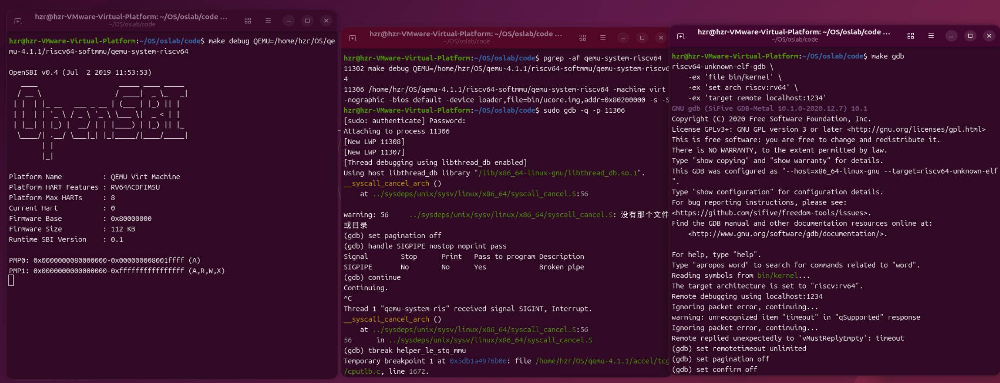

图 1 展示了三个终端的布局及最初连接时的输出。实际调试中，两个暂停层次的关系贯穿整个过程：终端 2 停住 QEMU 时，终端 3 的远程请求也会等待；终端 2 恢复运行后，终端 3 才能继续收到应答。

### 三、确定目标访存指令

在终端 3 设置指令断点，连续运行到 `kern_init` 的栈写入位置：

```gdb
hbreak *0xffffffffc02000ee
continue
x/i $pc
info registers pc sp ra satp
```

观察到：

```text
pc   = 0xffffffffc02000ee
指令 = sd ra,8(sp)
sp   = 0xffffffffc0203ff0
ra   = 0x80000a02
satp = 0x8000000000080204
```

该指令将 `ra` 的 8 字节值保存到栈上，其有效地址为：

```text
VA = sp + 8
   = 0xffffffffc0203ff0 + 8
   = 0xffffffffc0203ff8
```

`pc` 指向指令本身，`sp+8` 才是这次数据存储访问的地址。`satp` 的 MODE 为 8，表明此时已启用 Sv39。

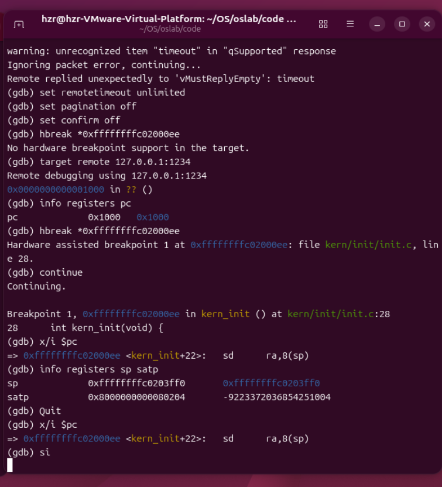

接着切换到终端 2，按 **Ctrl-C** 暂停 QEMU，设置存储辅助函数的临时断点，再恢复 QEMU：

```gdb
tbreak helper_le_stq_mmu
continue
```

回到终端 3 执行：

```gdb
si
```

终端 2 随即停在该辅助函数中。终端 3 等待这一条来宾指令执行完成，接下来的页表和 TLB 单步操作均在终端 2 进行。

### 四、观察软件 TLB 未命中及调用路径

#### 4.1 主 TLB 查询

在终端 2 进入 `store_helper`，执行到 TLB 项已取出的地方：

```gdb
step
until 1508
p mmu_idx
p index
p/x tlb_addr
p/x *entry
until 1519
step
finish
```

相关代码位于 `accel/tcg/cputlb.c`：

```c
uintptr_t mmu_idx = get_mmuidx(oi);
uintptr_t index = tlb_index(env, mmu_idx, addr);
CPUTLBEntry *entry = tlb_entry(env, mmu_idx, addr);
target_ulong tlb_addr = tlb_addr_write(entry);
```

`mmu_idx` 选择对应访问上下文的软件 TLB，本次值为 1，对应 S 模式。`tlb_index` 根据虚拟页号与表掩码定位槽位，本次 `index=3`；随后读取该槽位的写访问标签 `addr_write`。

实测结果为：

```text
mmu_idx   = 1
index     = 3
tlb_addr  = 0xffffffffffffffff
addr_read = 0xffffffffffffffff
addr_write= 0xffffffffffffffff
addr_code = 0xffffffffffffffff
addend    = 0xffffffffffffffff
tlb_hit(...) 返回 false
```

`include/exec/cpu-all.h` 中的 C 查询代码为：

```c
static inline bool tlb_hit_page(target_ulong tlb_addr, target_ulong addr)
{
    return addr == (tlb_addr & (TARGET_PAGE_MASK | TLB_INVALID_MASK));
}

static inline bool tlb_hit(target_ulong tlb_addr, target_ulong addr)
{
    return tlb_hit_page(tlb_addr, addr & TARGET_PAGE_MASK);
}
```

它先取出目标页地址 `0xffffffffc0203000`，再与保留无效标志的 TLB 标签比较。当前槽位处于无效状态，因此返回 `false`。

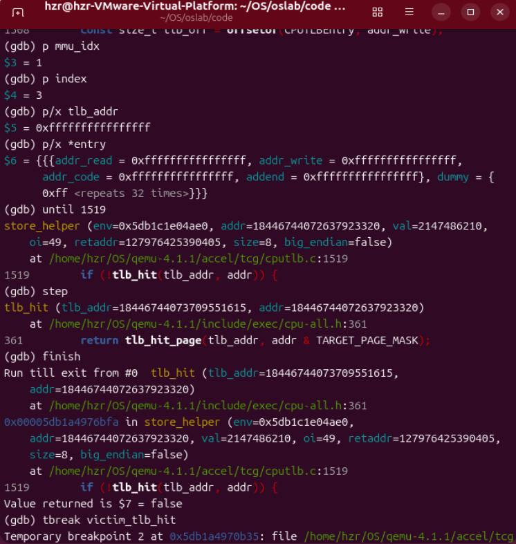

#### 4.2 victim TLB 查询

主表未命中后，继续观察 victim TLB：

```gdb
tbreak victim_tlb_hit
continue
p mmu_idx
p index
p/x page
finish
```

结果为：

```text
mmu_idx = 1
index   = 3
page    = 0xffffffffc0203000
返回值  = false
```

QEMU 4.1.1 还维护了一个 8 项的 victim TLB，用来保存从主表替换出去的表项。`victim_tlb_hit` 逐项比较访问标签，命中时将找到的项与主表槽位交换。本次查询仍返回 `false`，因此需要重新进行地址翻译。

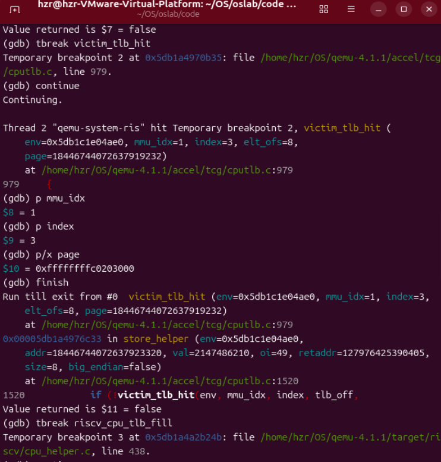

#### 4.3 进入 RISC-V 地址翻译

继续设置临时断点并打印调用栈：

```gdb
tbreak riscv_cpu_tlb_fill
continue
p/x address
p access_type
p mmu_idx
bt 8
```

输出显示 `address=0xffffffffc0203ff8`、`access_type=MMU_DATA_STORE`、`mmu_idx=1`，与来宾指令的访问地址和类型一致。

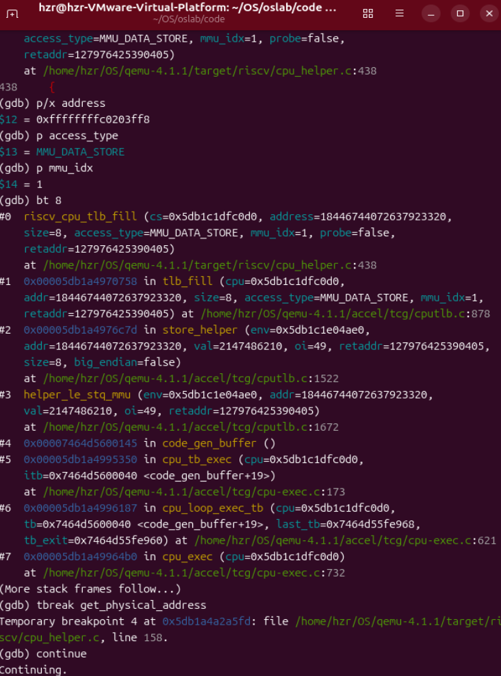

根据调用栈和单步结果，本次执行过程为：

```text
cpu_exec → cpu_loop_exec_tb → cpu_tb_exec
  → 执行 code_gen_buffer 中的宿主代码
    → helper_le_stq_mmu
      → store_helper
        → tlb_hit：false
        → victim_tlb_hit：false
        → tlb_fill
          → riscv_cpu_tlb_fill
            → get_physical_address
            → PMP 权限检查
            → tlb_set_page
        → stq_le_p：完成宿主内存写入
```

决定是否进入翻译函数的关键分支位于 `store_helper`：

```c
if (!tlb_hit(tlb_addr, addr)) {
    if (!victim_tlb_hit(env, mmu_idx, index, tlb_off,
                        addr & TARGET_PAGE_MASK)) {
        tlb_fill(env_cpu(env), addr, size, MMU_DATA_STORE,
                 mmu_idx, retaddr);
    }
    /* 重新取得回填后的表项 */
}
```

这里两次判断的结果均为未命中，执行因而进入 `tlb_fill`，再通过 CPU 的架构相关回调进入 `riscv_cpu_tlb_fill`。

### 五、单步分析 Sv39 页表查询

#### 5.1 从 satp 取得根页表

在终端 2 继续：

```gdb
tbreak get_physical_address
continue
p/x addr
p/x env->satp
until 237
p levels
p ptidxbits
p ptesize
p/x base
p ptshift
```

得到：

```text
addr      = 0xffffffffc0203ff8
satp      = 0x8000000000080204
levels    = 3
ptidxbits = 9
ptesize   = 8
base      = 0x80204000
ptshift   = 18
```

将 `satp` 分解为 MODE、ASID 和根页表物理页号：

```text
MODE = 8                 → Sv39
ASID = 0
PPN  = 0x80204
根页表物理地址 = PPN << 12 = 0x80204000
```

Sv39 的页内偏移占 12 位，每一级索引占 9 位。目标地址分解为：

| 字段 | 计算 | 结果 |
|---|---|---|
| VPN[2] | `(addr >> 30) & 0x1ff` | `511` |
| VPN[1] | `(addr >> 21) & 0x1ff` | `1` |
| VPN[0] | `(addr >> 12) & 0x1ff` | `3` |
| 页内偏移 | `addr & 0xfff` | `0xff8` |

#### 5.2 读取根页表第 511 项

页表遍历由一个最多执行三次的循环实现：

```c
for (i = 0; i < levels; i++, ptshift -= ptidxbits) {
    target_ulong idx = (addr >> (PGSHIFT + ptshift)) &
                      ((1 << ptidxbits) - 1);
    target_ulong pte_addr = base + idx * ptesize;
    /* 检查读取 PTE 的物理访问权限 */
    target_ulong pte = ldq_phys(cs->as, pte_addr);
    target_ulong ppn = pte >> PTE_PPN_SHIFT;
    /* 检查当前 PTE，决定继续遍历还是使用叶子映射 */
}
```

`ptshift` 从 18 开始，每轮减 9，依次选择 VPN[2]、VPN[1]、VPN[0]。`base` 保存当前页表的物理基址，`idx` 选择其中的一个 8 字节表项。`ldq_phys` 从来宾物理内存读取 PTE。

执行到第 254 行时检查：

```gdb
until 254
p i
p idx
p/x base
p/x pte_addr
p/x pte
next
p/x ppn
```

实测：

```text
i        = 0
idx      = 511
base     = 0x80204000
pte_addr = 0x80204ff8
pte      = 0x200000cf
ppn      = 0x80000
```

地址计算与输出一致：

```text
pte_addr = 0x80204000 + 511 × 8 = 0x80204ff8
ppn      = 0x200000cf >> 10     = 0x80000
```

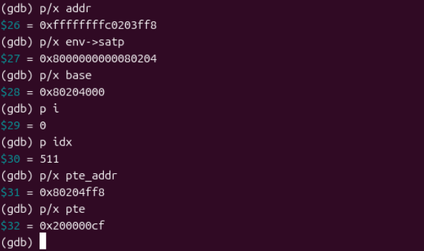

#### 5.3 判断叶子项、权限和 A/D 位

`pte=0x200000cf` 的低 8 位为 `11001111`，各标志位含义如下。

| 标志位 | 值 | 本次访问中的含义 |
|---|---:|---|
| V | 1 | 页表项有效 |
| R | 1 | 允许读取 |
| W | 1 | 允许写入 |
| X | 1 | 允许执行 |
| U | 0 | supervisor 页 |
| G | 0 | 未设置全局标志 |
| A | 1 | 已访问 |
| D | 1 | 已写入 |

遍历函数在读出 PTE 后依次处理以下分支：

| 检查 | 作用 | 本次结果 |
|---|---|---|
| `!(pte & PTE_V)` | 拒绝无效项 | V=1，通过 |
| `!(pte & (PTE_R \| PTE_W \| PTE_X))` | 识别下一级页表，执行 `base=ppn<<12` | RWX 均为 1，当前项是叶子 |
| W=1 且 R=0 的保留组合 | 拒绝非法权限编码 | R=1，通过 |
| U/S 与 SUM 检查 | 判断当前模式能否访问该页 | S 模式访问 U=0 的页，通过 |
| `ppn & ((1ULL << ptshift) - 1)` | 检查大页物理地址对齐 | PPN 低 18 位为 0，通过 |
| store 对 W 位的检查 | 确认写权限 | W=1，通过 |

这里 `i=0` 表示 QEMU 循环的第一轮，对应 Sv39 的根级，也就是通常所说的 level 2。根级已经是叶子，因此直接得到一个 **1 GiB 大页映射**。Sv39 的任一级都可以出现叶子项，分别形成 1 GiB、2 MiB、4 KiB 映射。[RISC-V Sv39 规范](https://docs.riscv.org/reference/isa/priv/supervisor.html)给出了这一规则。

这也与 ucore 的启动页表定义一致：`kern/init/entry.S` 将前 511 项置零，最后一项写为：

```asm
.quad (0x80000 << 10) | 0xcf
```

接着观察 A/D 位处理：

```gdb
until 291
next
p/x pte
p/x updated_pte
```

相关代码为：

```c
target_ulong updated_pte = pte | PTE_A |
    (access_type == MMU_DATA_STORE ? PTE_D : 0);
if (updated_pte != pte) {
    /* 原子更新页表项 */
}
```

本次 `pte` 和 `updated_pte` 均为 `0x200000cf`，A、D 原本就已经置位，条件为假，继续使用原表项。

#### 5.4 计算物理地址

执行到物理页基址计算处：

```gdb
until 334
next
p/x addr
p/x *physical
p/x (addr & 0xfff)
p/x (*physical | (addr & 0xfff))
p i
```

代码为：

```c
target_ulong vpn = addr >> PGSHIFT;
*physical = (ppn | (vpn & ((1L << ptshift) - 1))) << PGSHIFT;
```

本次 `ptshift=18`。根级大页的 PPN 提供高位物理页号，VPN 的低 18 位提供大页内的子页位置：

```text
vpn & ((1 << 18) - 1) = 0x203
物理页基址 = (0x80000 | 0x203) << 12
           = 0x80203000
页内偏移   = 0xff8
完整 PA    = 0x80203000 | 0xff8
           = 0x80203ff8
```

也可以从大页映射整体计算：

```text
映射起点：VA 0xffffffffc0000000 → PA 0x80000000
大页内偏移：0x203ff8
最终地址：0x80000000 + 0x203ff8 = 0x80203ff8
```

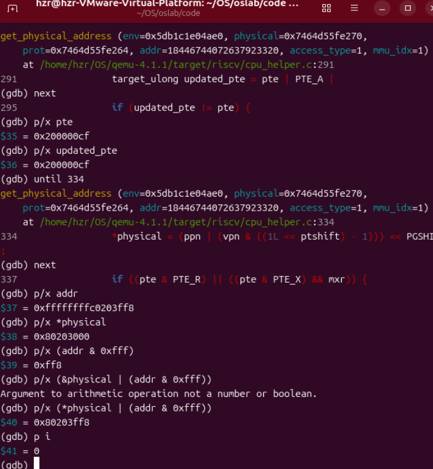

输出中的 `*physical=0x80203000` 是给软件 TLB 使用的 4 KiB 物理页基址，补上偏移后才得到此次存储的完整地址。此时 `i` 仍为 0，整个查表过程在根级完成。

### 六、回填软件 TLB 并完成存储

#### 6.1 观察回填参数和新表项

从翻译函数返回，并进入 `tlb_set_page`：

```gdb
finish
p/x pa
p prot
until 472
step
p/x vaddr
p/x paddr
p prot
p mmu_idx
p size
finish
set $fast = &cpu->neg.tlb.f[mmu_idx]
p/x $fast->table[(address >> 12) & ($fast->mask >> 5)]
```

翻译返回成功，`prot=7`，表示 QEMU 的读、写、执行权限组合。`riscv_cpu_tlb_fill` 在后续 PMP 检查通过后调用 `tlb_set_page`：

| 参数 | 值 |
|---|---|
| `vaddr` | `0xffffffffc0203000` |
| `paddr` | `0x80203000` |
| `prot` | `7` |
| `mmu_idx` | `1` |
| `size` | `4096` |

回填后的表项为：

```text
addr_read  = 0xffffffffc0203000
addr_write = 0xffffffffc0203000
addr_code  = 0xffffffffc0203000
addend     = 0x746507e00000
```

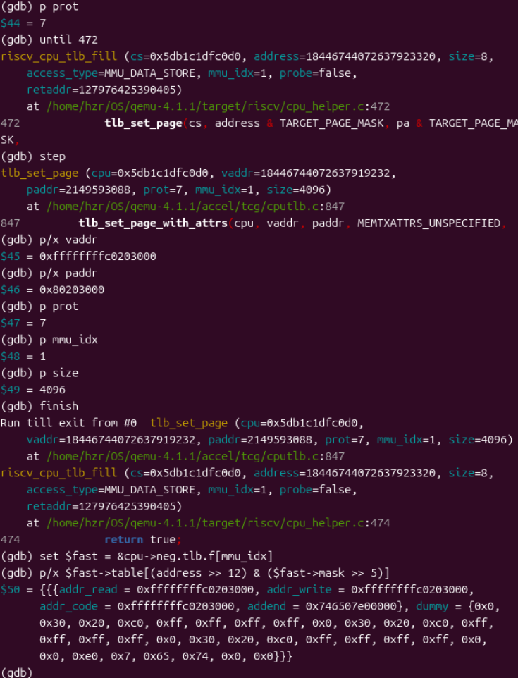

页表描述的是 1 GiB 大页，而这次回填的 `size=4096`。原因在于 QEMU 4.1.1 的 RISC-V 回填函数按 `TARGET_PAGE_SIZE` 建立当前 4 KiB 子页的缓存项，供后续快速访存使用。

#### 6.2 从来宾地址得到宿主地址

`tlb_set_page_with_attrs` 根据来宾物理地址找到对应内存区域，再取得宿主 RAM 指针，并在表项中保存：

```text
addend = 宿主页基址 - 来宾虚拟页基址
```

因此普通 RAM 访问命中后，可以直接通过 `addr + addend` 得到宿主指针。本次按 64 位地址算术计算：

```text
HVA = (0xffffffffc0203ff8 + 0x746507e00000) mod 2^64
    = 0x7464c8003ff8
```

继续在 `store_helper` 中观察：

```gdb
tbreak /home/hzr/OS/qemu-4.1.1/accel/tcg/cputlb.c:1608
continue
p/x addr
p/x entry->addend
p/x haddr
p/x val
until 1630
next
x/gx haddr
```

实测 `haddr=0x7464c8003ff8`、`val=0x80000a02`。单步执行 `stq_le_p(haddr, val)` 后，该地址的 8 字节内容变为 `0x0000000080000a02`。

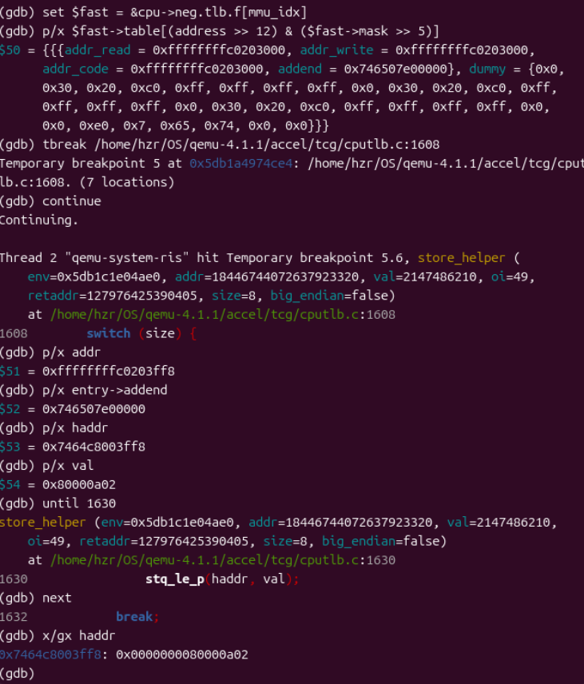

在终端 2 执行 `continue`，终端 3 的 `si` 返回。检查来宾结果：

```gdb
info registers pc
x/gx 0xffffffffc0203ff8
```

得到 `pc=0xffffffffc02000f0`，目标内存中为 `0x0000000080000a02`。

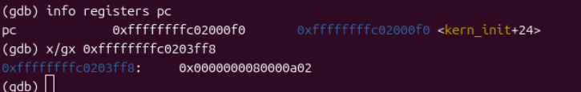

两侧观察对应同一次写入：来宾通过高虚拟地址看到保存的 `ra`，QEMU 则通过宿主 RAM 指针完成了这次操作。目标指令实际采用 RISC-V 压缩编码，因此执行后 PC 前进 2 字节。

### 七、重复访存，观察 TLB 命中的快速路径

#### 7.1 重放同一条 store

首次存储完成后，在终端 3 将 PC 恢复到目标指令，保持 `sp`、`ra` 不变：

```gdb
set $pc = 0xffffffffc02000ee
x/i $pc
info registers sp ra
```

在终端 2 按 Ctrl-C，设置按来宾 PC 过滤的临时断点：

```gdb
tbreak cpu_tb_exec if itb->pc == 0xffffffffc02000ee
continue
```

回到终端 3 执行 `si`，终端 2 停在准备执行该指令所在翻译块的位置。

#### 7.2 查看 TCG 生成的宿主指令

在终端 2 取得翻译块的宿主代码地址：

```gdb
p/x itb->pc
set $code_start = itb->tc.ptr
p/x $code_start
disassemble /r $code_start, $code_start+100
```

结果为：

```text
itb->pc     = 0xffffffffc02000ee
$code_start = 0x7464d5600100
```

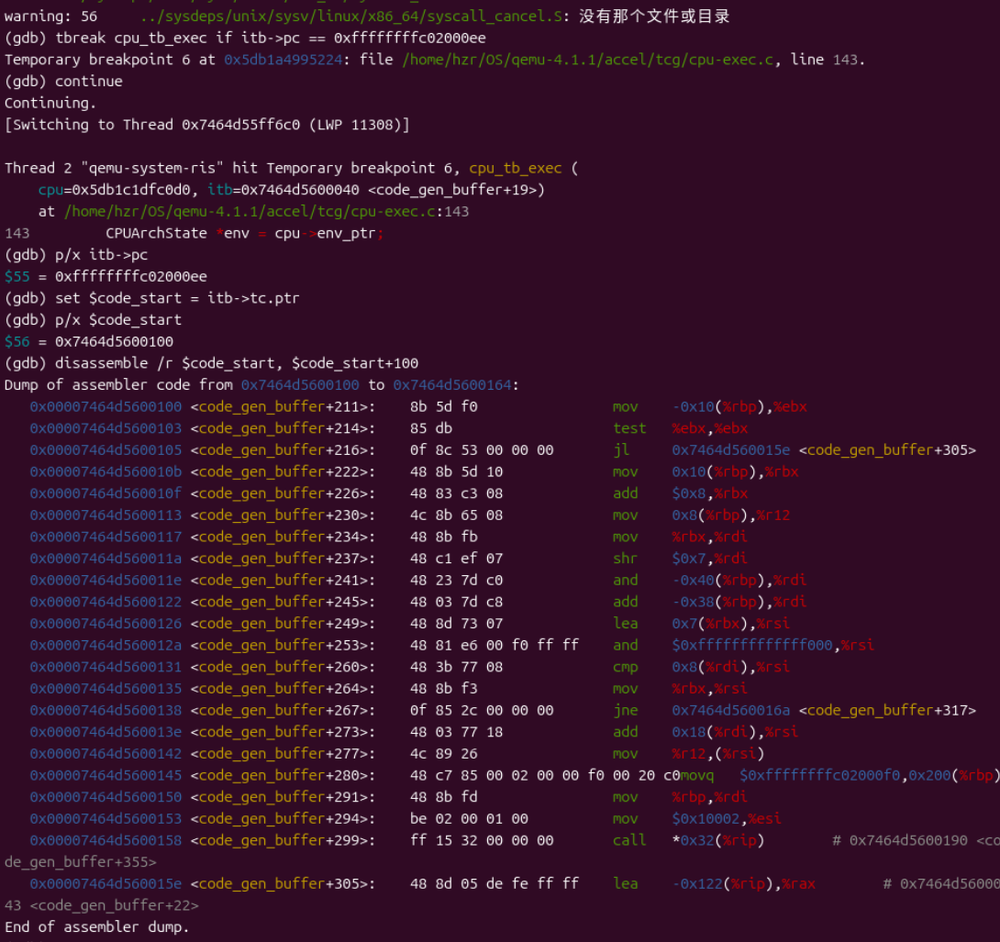

其中 TLB 查询和写入的关键片段为：

```asm
0x7464d5600117: mov %rbx,%rdi
0x7464d560011a: shr $0x7,%rdi
0x7464d560011e: and -0x40(%rbp),%rdi
0x7464d5600122: add -0x38(%rbp),%rdi
0x7464d5600126: lea 0x7(%rbx),%rsi
0x7464d560012a: and $0xfffffffffffff000,%rsi
0x7464d5600131: cmp 0x8(%rdi),%rsi
0x7464d5600135: mov %rbx,%rsi
0x7464d5600138: jne 0x7464d560016a
0x7464d560013e: add 0x18(%rdi),%rsi
0x7464d5600142: mov %r12,(%rsi)
```

进入该片段时，`rbx` 保存来宾访问地址，`r12` 保存待写入的 `ra`。前四条指令通过移位、掩码和表基址定位 TLB 项，结果保存在 `rdi`。这里每项占 32 字节，移位量为 `12-5=7`，配合掩码直接形成表内字节偏移。

`lea 0x7(%rbx),%rsi` 考虑 8 字节访问的最后一个字节，再取其页地址，用于检查整次访问是否能走同一页的快速路径。`cmp` 将它与表项偏移 8 处的 `addr_write` 比较。若不匹配，`jne` 跳转到慢路径；匹配则继续加上表项偏移 24 处的 `addend`，直接进行宿主存储。

#### 7.3 单步确认比较结果和分支去向

在本次生成代码的比较指令处设置临时断点：

```gdb
tbreak *0x7464d5600131
continue
p/x $rsi
x/gx ($rdi+8)
si
p ($eflags >> 6) & 1
si
si
p/x $pc
x/3i $pc
```

观察到：

```text
比较值 RSI           = 0xffffffffc0203000
表项 addr_write      = 0xffffffffc0203000
cmp 后 ZF            = 1
执行 jne 后 PC       = 0x7464d560013e
```

两个标签相等，`cmp` 设置 ZF=1。中间的 `mov` 保留标志位，随后 `jne` 不跳转，执行落在紧接着的 `add` 上。

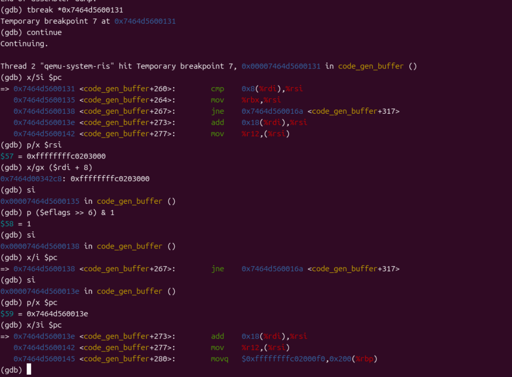

继续执行 `add` 和存储指令：

```gdb
si
p/x $rsi
p/x $r12
si
p/x $pc
x/gx $rsi
```

结果为：

```text
add 后 RSI = 0x7464c8003ff8
R12        = 0x80000a02
mov 后 PC  = 0x7464d5600145
内存内容   = 0x0000000080000a02
```

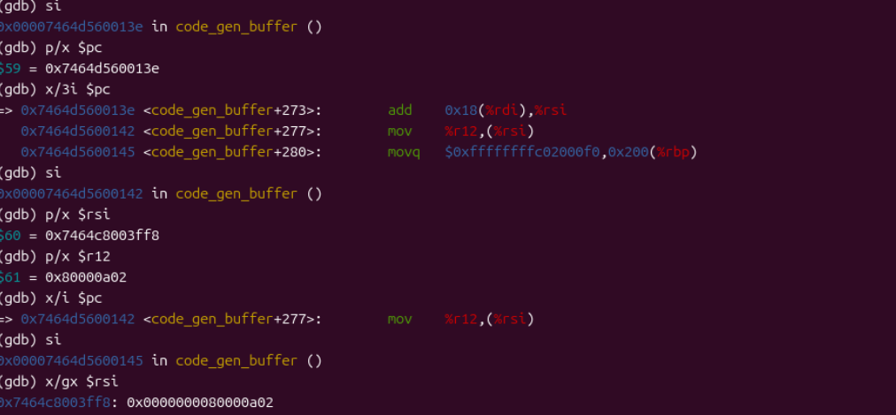

恢复终端 2 后，终端 3 再次返回到 `0xffffffffc02000f0`，栈中仍保存 `0x80000a02`。

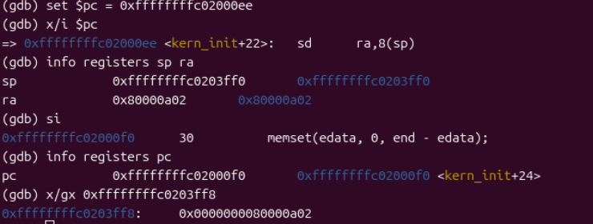

#### 7.4 C 查询代码与生成代码的关系

本实验观察到了两种实现位置：`store_helper` 中的 C 函数 `tlb_hit`，以及 `code_gen_buffer` 中执行的 x86 标签比较。

这两者通过 TCG 的翻译与执行过程联系起来：

```text
翻译阶段：
RISC-V 存储指令译码
  → 生成 TCG qemu_st 操作
  → x86 后端 tcg_out_qemu_st
  → tcg_out_tlb_load 生成 TLB 查询、比较和分支
  → 生成宿主写入指令与慢路径 helper 调用

执行阶段：
运行已生成的宿主代码
  → TLB 标签匹配：add + mov，直接访问 RAM
  → 标签不匹配或需要特殊处理：进入 C helper
```

因此，在 `tcg_out_tlb_load` 中看到的是查询代码的生成；在本次 `cmp` 和 `jne` 处单步，看到的才是这次访存实际进行的 TLB 查询。首次未命中时执行 C 慢路径完成查表，重复访问则在生成的机器码中直接完成。

### 八、Bare 模式下的访存对照

#### 8.1 在分页开启前选择存储指令

完成 Sv39 实验后重新启动 QEMU，在终端 2 附加新进程，并设置条件断点：

```gdb
break riscv_cpu_tlb_fill if address == 0x80205000 && access_type == 1
continue
```

终端 3 重新连接后，停在保存 hart ID 的指令：

```gdb
target remote 127.0.0.1:1234
hbreak *0x80200008
continue
x/i $pc
info registers pc t0 a0 satp
```

观察到：

```text
pc   = 0x80200008
指令 = sd a0,0(t0)
t0   = 0x80205000
a0   = 0
satp = 0
```

这条指令将 hart ID 0 写入 `boot_hartid`，此时 `satp=0`，地址转换模式为 Bare。

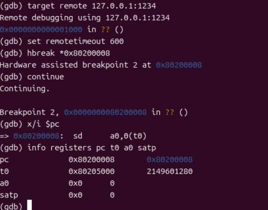

#### 8.2 观察恒等转换分支

在终端 3 执行 `si`，终端 2 命中 `riscv_cpu_tlb_fill`。检查调用栈并进入翻译函数：

```gdb
bt 8
tbreak get_physical_address
continue
p/x env->satp
until 197
p vm
next
p/x addr
p/x *physical
```

调用栈仍包含 `helper_le_stq_mmu → store_helper → tlb_fill → riscv_cpu_tlb_fill`。进入 `get_physical_address` 后，`vm=0`，执行 Bare 分支：

```c
case VM_1_10_MBARE:
    *physical = addr;
    *prot = PAGE_READ | PAGE_WRITE | PAGE_EXEC;
    return TRANSLATE_SUCCESS;
```

执行赋值后，`addr` 和 `*physical` 均为 `0x80205000`。这条路径直接采用原地址作为来宾物理地址。

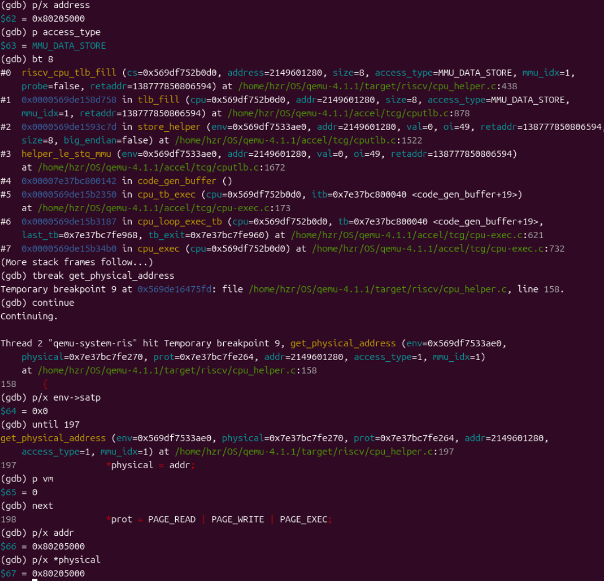

#### 8.3 Bare 模式仍然回填软件 TLB

继续执行到回填位置：

```gdb
next
p *prot
finish
p/x pa
until 472
step
p/x vaddr
p/x paddr
p prot
p mmu_idx
p size
```

观察到：

```text
vaddr   = 0x80205000
paddr   = 0x80205000
prot    = 7
mmu_idx = 1
size    = 4096
```

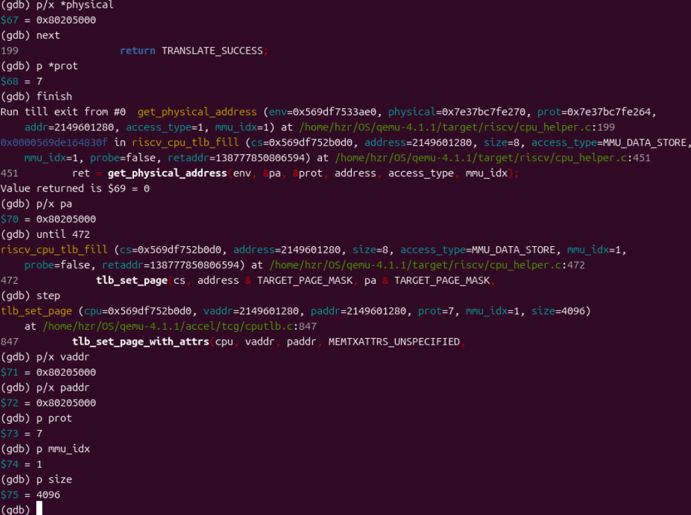

Sv39 和 Bare 在 `get_physical_address` 中采用不同的转换分支，但成功返回后都会执行 `tlb_set_page`。即使来宾地址等于物理地址，QEMU 仍需找到它在宿主进程中对应的 RAM 或设备区域，这些信息同样可以用软件 TLB 缓存。

### 九、QEMU 软件 TLB 与真实 CPU TLB 的逻辑区别

| 比较项 | 真实 CPU 的地址翻译 TLB | QEMU 4.1.1 的软件 TLB |
|---|---|---|
| 核心作用 | 缓存虚拟页到物理页的地址转换及权限信息 | 加速来宾访存，并连接到宿主 RAM 或设备访问处理 |
| 命中后的寻址 | 组合物理页号与页内偏移，发起物理访存 | 普通 RAM 通过 `guest_addr + addend` 得到宿主虚拟地址 |
| Bare 模式 | 体系结构上直接以访问地址作为物理地址 | 仍使用软件 TLB，缓存恒等来宾映射及宿主访存信息 |
| 条目内容 | 由硬件实现组织地址标签、物理页号、权限等 | 包含 `addr_read`、`addr_write`、`addr_code`、`addend` 等字段 |
| 查询实现 | 由硬件进行匹配，结构取决于具体处理器 | 主表索引与标签比较、8 项 victim 表，以及 TCG 生成的快速路径 |
| 本次大页处理 | Sv39 根级叶子描述 1 GiB 映射 | 从大页映射中取出当前 4 KiB 子页，按 4096 字节回填 |

Bare 对照揭示了软件 TLB 的另一层用途：除了缓存来宾地址转换，它还缓存“如何在宿主中完成这次访问”。这也解释了为什么调试时会同时出现 GVA、GPA、HVA 三种地址，以及为什么页表翻译完成后还需要计算 `addend`。

### 十、调试过程中的现象与学习收获

**1. 外层暂停会让内层连接超时。** 最初终端 2 已附加 QEMU，但停在 GDB 提示符；终端 3 连接后出现 `timeout`，随后设置 `hbreak` 又提示目标不支持硬件断点。让终端 2 `continue` 并在终端 3 重新连接后，能读到 `pc=0x1000`，硬件断点也成功建立。由此理解了 QEMU 进程、GDB stub 与来宾 CPU 的运行关系。

**2. 三级页表在本次只循环了一轮。** `levels=3` 给出最大遍历深度，而是否继续由当前 PTE 的性质决定。本次 `i=0`、`idx=511`、`pte=0x200000cf`，根项的 R/W/X 已经表明它是叶子。结合启动页表定义，可以把“1 GiB 大页”对应到实际读出的那个 8 字节表项。

**3. 指针的地址与指针指向的数值不同。** 计算完整物理地址时，曾输入 `&physical | (addr & 0xfff)`，GDB 报类型错误。`physical` 是输出参数指针，`*physical` 才是翻译得到的物理页基址；改为 `*physical | (addr & 0xfff)` 后得到 `0x80203ff8`。

**4. 一条来宾指令可以对应多条宿主指令。** 来宾执行的是 `sd ra,8(sp)`，宿主却需要先定位 TLB、比较标签、选择分支、计算 RAM 指针，再执行 `mov`。命中时的 `ZF=1` 和 `jne` 顺序执行，让“TLB 命中”成为可以逐条观察的机器指令行为。

**5. 地址翻译成功与实际写入是两个连续步骤。** `get_physical_address` 给出物理页基址，`tlb_set_page` 建立缓存，`stq_le_p` 或生成代码中的 `mov` 才完成写入。最终在来宾地址与宿主地址读到相同的 `0x80000a02`，把整个过程连接起来。

**6. 大模型帮助建立了可操作的学习路径。** 调试时先让模型根据 QEMU 版本定位相关函数，再围绕具体输出追问 `mmu_idx`、页表循环、大页 PPN 组合和 TCG 快速路径。每次问题都对应下一组断点或变量检查：从 `tlb_hit=false` 走到页表项，从 `i=0` 解释大页，再从宿主 `cmp/jne` 解释命中。阅读源码、推导地址和实际单步在这一过程中相互补充。

---

## 六、测试与验证

**测试截图：**

1. 编译链接成功（`make` 输出，生成 `bin/kernel` 与 `bin/ucore.img`）：


2. 内核启动成功（`make qemu` 输出）：管理器已切换为 `best_fit_pmm_manager`，输出物理内存映射 `[0x80000000, 0x87ffffff]`，`check_alloc_page() succeeded!`，并打印 `satp` 的虚拟/物理地址：


3. 自动评分通过（`make grade`，注入 `test_page_init` / `test_best_fit` 测试）：

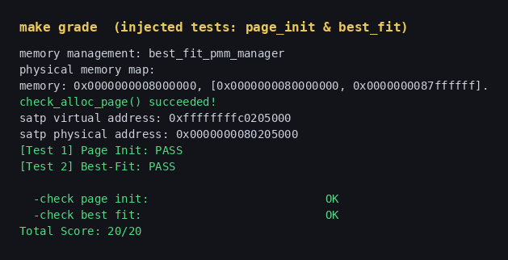

评分结果为 **20/20**：

```
  -check page init:                          OK
  -check best fit:                           OK
Total Score: 20/20
```

其中注入的两个测试分别验证了：

- **`[Test 1] Page Init: PASS`**：`va_pa_offset` 正确、设备树内存范围有效、`npage` 等于 `PPN(mem_end)` 且大于 `nbase`、`pages` 非空且页对齐并位于 `end` 之后、空闲页数在合法范围内、内核镜像尾页与描述符数组所在页均保持 `PageReserved`、`page2pa/pa2page` 可逆。
- **`[Test 2] Best-Fit: PASS`**：`pmm_manager` 指向 `best_fit_pmm_manager`（即已切换到 Best-Fit）。

4. Buddy System 自测通过（临时切换 `buddy_pmm_manager` 后 `make qemu`）：输出 `memory management: buddy_pmm_manager`、空闲区大小 `31930 pages` 与 `check_buddy() succeeded!`，即 `buddy_check` 覆盖的单页往返、2 的幂取整与对齐、伙伴分裂/合并、超额分配、结构不变量等断言全部通过：

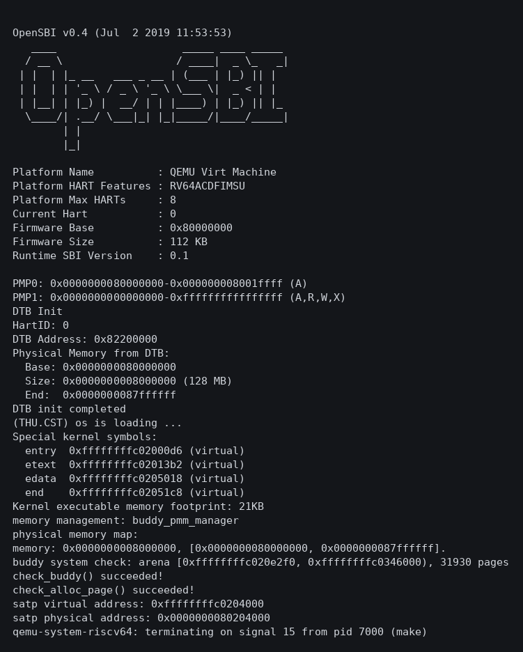

5. SLUB 自测通过（临时在 `kern_init` 中调用 `slub_init()` + `slub_check()` 后 `make qemu`）：输出 `slub check start` 与 `check_slub() succeeded!`，即各 size class 分配/释放、对象不重叠与 freelist 复用、大对象整页路径、混合分配无泄漏等断言全部通过：

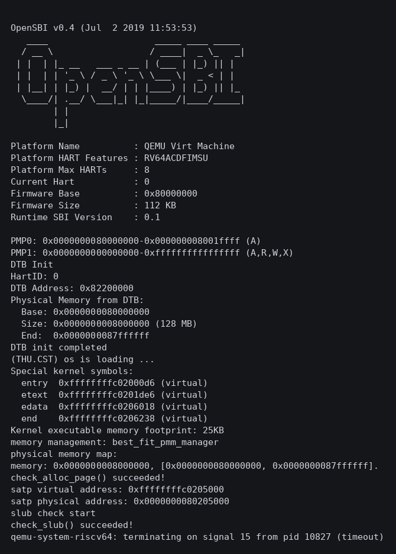

---

## 七、实验总结与收获

### 7.1 本实验重要知识点与 OS 原理对照

| 本实验知识点 | OS 原理对应 | 含义、关系与差异 |
| --- | --- | --- |
| Page 描述符数组、`page2pa/pa2page` | 页帧（Page Frame）管理 | 用数组下标 + `nbase` 建立「物理页号 ↔ 描述符」的双向映射，是 OS 管理物理内存的基础数据结构 |
| `free_area_t` 空闲链表 | 空闲区管理 / 空闲链表 | 用双向链表组织连续空闲块，`property` 记块大小；是连续分配算法的通用载体 |
| First-Fit / Best-Fit | 连续内存分配算法 | 原理课讲「首次适应/最佳适应」，实验用 Page 链表落地；差异在于选择「第一个够大」还是「最小够大」的块 |
| Buddy System（伙伴系统） | 连续内存分配算法 | 把内存按 2 的幂分块，「二分分裂 + 同阶伙伴合并」，用位运算 `off ^ (1<<k)` 定位伙伴；是 Linux 等 OS 底层页分配器的原型 |
| SLUB / slab 分配器 | 内存对象分配 / 对象缓存 | 两层架构：页分配器之上再切分固定大小对象，同大小对象聚合为 cache，空闲对象内嵌 freelist；对应原理课的「slab/对象缓存」 |
| 内碎片 / 外碎片 | 内存碎片 | 分配时「分裂大块」产生外部碎片；Best-Fit 旨在减少残留，但可能产生更细碎的小块 |
| 页表 / PTE / Sv39 | 页表与地址翻译 | 实验只建一个 1GiB 大页的启动页表，是原理课「多级页表、页表项格式、虚实映射」的最小化落地 |
| `satp` 寄存器 | 页表基址寄存器 | `satp` 的 MODE 字段使能 Sv39，PPN 字段指向根页表；是硬件地址翻译的入口 |
| TLB / `sfence.vma` | 快表（TLB） | 切换页表后必须刷新 TLB，否则旧映射会残留导致错误 |
| 设备树（DTB）探测内存 | 硬件探测 / 系统启动 | bootloader 通过 DTB 告知内核内存与外设布局，是「系统如何知道硬件」的机制 |
| `PADDR`/`KADDR`、`va_pa_offset` | 地址重定位 | 内核运行在高虚拟地址，但物理内存只有 128MB，需要偏移量换算；与原理课的「逻辑地址→物理地址」同构 |

### 7.2 OS 原理中重要、但本实验未覆盖的知识点

1. **虚拟内存管理 / 缺页中断与请求调页**（对应 lab3/lab4）：本实验只建立静态的 1GiB 大页映射，没有按需分配、缺页异常处理和页面置换。
2. **页面置换算法**（LRU、CLOCK 等）：物理页只「分配/回收」，没有「换入/换出」。
3. **段式存储管理 / 段页式结合**：只涉及页式（Sv39），未实现段表与段的权限/共享语义。
4. **进程地址空间与内核/用户态隔离**：`satp` 只有一个启动页表，还没有为每个进程建立独立页表、也没有 U 态与 S 态的权限切换。
5. **反置页表 / 多级页表动态伸缩**：启动页表是手工静态构造的，未实现通用页表分配器。
6. **内存保护与共享内存**：PTE 的 R/W/X/U 位只是「理解」，尚未用于实际保护策略。

### 7.3 AI 协作开发的经验与遇到的 bug

**AI 生成代码过程中遇到并解决的问题：**

1. **`va_pa_offset` 未先设置就调用 `PADDR`**：最初的 `page_init` 实现把 `PADDR(freemem)` 放在 `va_pa_offset` 赋值之前，导致 `PADDR` 用偏移量 0 换算，得到错误的物理地址。解决：把 `va_pa_offset = PHYSICAL_MEMORY_OFFSET` 提到所有 `PADDR` 调用之前。这是「初始化顺序」类 bug，说明底层代码对全局状态的赋值时机很敏感。
2. **描述符数组大小估算**：一开始想当然地把数组大小当作 `npage * sizeof(struct Page)`，忽略了「描述符只覆盖 `[nbase, npage)`」这一关键点，导致 `freemem` 计算偏大、浪费一截内存。解决：改为 `(npage - nbase) * sizeof(struct Page)`。这是「页号上界」与「描述符个数」概念的混淆。
3. **Best-Fit 测试对「最小满足块」的强约束**：早期实现沿用了 First-Fit「找到就 break」的逻辑，结果 `best_fit_check` 里 `assert(p0 + 4 == p1)` 失败（因为选错了块）。解决：改为完整遍历、记录 `property` 最小的块。这印证了「读懂测试用例能反过来约束实现」。
4. **Buddy System 的「非 2 的幂空闲区」与「合并级联」问题**：空闲区页数（31930）不是 2 的幂，且自测时周围内存仍是空闲的，释放两个相邻半块后合并出的块会继续与空闲伙伴向上「级联」，使「释放后某块一定是 4 页」这类断言不稳定。解决：① `init_memmap` 按贪心最大 2 的幂分解并保证块对齐，伙伴偏移用 `off ^ (1<<k)`、伙伴越界即停止合并；② 测试改用「释放低半块时伙伴仍被占用、不得提前合并（`property==2`）」这一确定性中间态，配合「`!PageProperty(p1) || p1->property >= 4`」判定合并确实发生，而非断言具体块大小。
5. **SLUB 的对象对齐与「内嵌 freelist」的取舍**：整页按 `obj_size` 切分时，若对象区紧贴页首 `slub_slab` 头（48 字节），32 字节及更大的 size class 对象只会对齐到 16 字节，`uint64_t` 写入可能触发未对齐访问。解决：对象区起点 `ROUNDUP(头尾, obj_size)`，牺牲少量页内空间换取每个对象按自身大小对齐。同时用 `cache == NULL` 标记大对象页、`npages` 记页数，使 `slub_free` 无需额外全局元数据即可区分「小对象 slab」与「大对象整页」。

**AI 协作的体会：**

- **让 AI 先读懂框架再写实现**：本实验的 `pmm_manager`、`free_area_t`、`Page` 描述符、`list.h` 是「约定」，AI 只有先复述清楚这些约定，才能写出与测试一致的代码。
- **测试是比文档更硬的规格**：`best_fit_check` 对分配结果有精确断言，AI 的初版被断言「打回」后，调整的收敛速度远快于靠人肉读代码推演。
- **分层验证仍然有效**：先 `make` 确认编译，再 `make qemu` 确认运行输出，最后 `make grade` 确认注入测试通过——三层逐步缩小问题范围。
